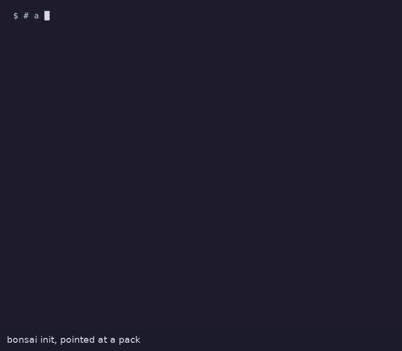
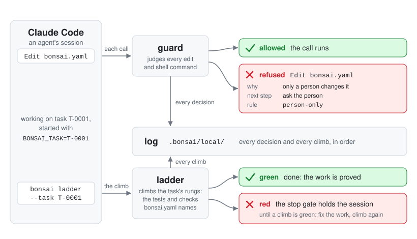
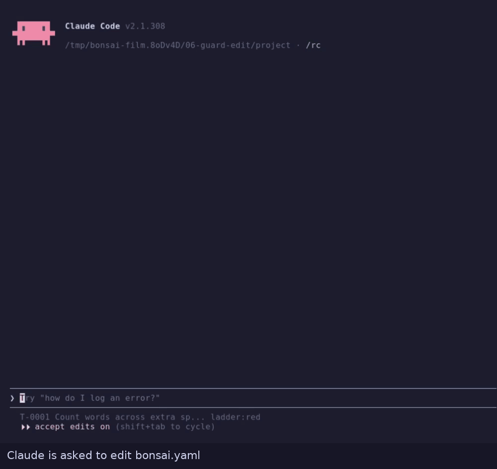

# Bonsai

Bonsai keeps Claude Code agents inside the lines you draw for a project: it refuses an edit of a file you protect,
logs every step, and holds a session until the project's checks prove the work is done. One Go program, nothing else
to install.

[](LICENSE)
[](https://github.com/LastStep/Bonsai/actions?query=workflow%3ACI)



## What you get

| Part | What it does for you | Try |
|---|---|---|
| **Formats** | A task, a run report, a log line and a question to you each have one fixed shape, so a person and a program read them the same way | `bonsai check --schema bonsai.task` |
| **Packs** | Roles, lanes, templates and protocols, delivered to Claude Code as plugins at a locked commit | `bonsai update` |
| **The guard** | Judges every edit and shell command an agent makes; it refuses a change to a protected file with the reason, the next step and the rule | `bonsai status` (the paths only a person changes) |
| **The recorder** | Keeps a log of each session in `.bonsai/local/log/`: prompts, tool calls, the guard's decisions | `bonsai logs` |
| **The ladder** | Runs your project's checks, cheapest first, and writes the proof a session needs before it may end | `bonsai ladder --task T-0001` |

## How it works

<picture>
  <source media="(prefers-color-scheme: dark)" srcset="docs/demos/how-it-works-dark.svg">
  
</picture>

Every refusal names its next step, and whether an agent or a person takes it.

## Install

Three steps: download the release, check it (its SHA-256, then `gh attestation verify`: Bonsai's own release
workflow built it), and run its installer. You need `gh` 2.97 or newer, logged in. One line at a time:

> [!NOTE]
> These lines name 1.0.0, Bonsai's first release, which is not out yet; until it is, the download fails.

<details>
<summary>Linux and WSL</summary>

```bash
cd "$(mktemp -d)"
curl -fsSLO https://github.com/LastStep/Bonsai/releases/download/v1.0.0/bonsai_1.0.0_linux_amd64.tar.gz
curl -fsSLO https://github.com/LastStep/Bonsai/releases/download/v1.0.0/checksums.txt
sha256sum -c --ignore-missing checksums.txt
gh attestation verify bonsai_1.0.0_linux_amd64.tar.gz -R LastStep/Bonsai --signer-workflow LastStep/Bonsai/.github/workflows/release.yml --source-ref refs/tags/v1.0.0 --deny-self-hosted-runners
tar -xzf bonsai_1.0.0_linux_amd64.tar.gz
sh install.sh
```

</details>

<details>
<summary>Windows (PowerShell, not as administrator)</summary>

```powershell
cd (New-Item -ItemType Directory (Join-Path $env:TEMP ("bonsai-" + [guid]::NewGuid())))
curl.exe -fsSLO https://github.com/LastStep/Bonsai/releases/download/v1.0.0/bonsai_1.0.0_windows_amd64.zip
curl.exe -fsSLO https://github.com/LastStep/Bonsai/releases/download/v1.0.0/checksums.txt
(Get-FileHash bonsai_1.0.0_windows_amd64.zip -Algorithm SHA256).Hash -eq ((Select-String -Path checksums.txt -SimpleMatch bonsai_1.0.0_windows_amd64.zip).Line -split ' ')[0]
gh attestation verify bonsai_1.0.0_windows_amd64.zip -R LastStep/Bonsai --signer-workflow LastStep/Bonsai/.github/workflows/release.yml --source-ref refs/tags/v1.0.0 --deny-self-hosted-runners
Expand-Archive bonsai_1.0.0_windows_amd64.zip -DestinationPath . -Force
powershell -NoProfile -ExecutionPolicy Bypass -File .\install.ps1
```

</details>

[`docs/install.md`](docs/install.md) says what each line proves, what to do when one fails, arm64, and the way back.
Bonsai's hook lines run the copy installed in `/usr/local/bin` or `C:\Program Files\Bonsai`, which only an
administrator writes, never one on the `PATH`: an agent cannot swap the program that judges it.

## A first project

From nothing to a first proof. You need `bonsai`, `git` and Claude Code (`bonsai status` names the oldest version
the pack needs). On a new machine, give git your name first: `git config --global user.name "<name>"` and
`git config --global user.email "<email>"`.

1. Make a folder and a repository:

   ```bash
   mkdir demo && cd demo && git init -b main
   ```

2. Link it to Bonsai's own pack, `base`. Its ref is a release tag (`base-v1.0.0` once it exists) or a 40-character
   commit; until the tag exists, take `main`'s commit, the first word the first line prints:

   ```bash
   git ls-remote https://github.com/LastStep/Bonsai refs/heads/main
   bonsai init --name demo --source https://github.com/LastStep/Bonsai --path packs/base --ref <commit>
   bonsai init --name demo --source https://github.com/LastStep/Bonsai --path packs/base --ref <commit> --yes
   ```

   The first `init` previews: at a terminal it asks; with none (a script, an agent) it ends refused, `needs-yes`,
   exit 4, writing nothing. With `--yes` it writes `bonsai.yaml` (a comment on every line), a block in `CLAUDE.md`,
   Bonsai's lines in `.claude/settings.json`, and in `.bonsai/` `STATE.md`, the tasks and sessions tables, a
   `.gitignore` and the lock; and, in Bonsai's home (`~/.bonsai`), an empty personal memory index.

3. Look at what you have:

   ```bash
   bonsai check
   bonsai status
   ```

   `check` says `no findings`, with a warning that the `base` plugin cannot be installed yet.

4. Open Claude Code in the folder, accept its question about trusting the folder, quit it, then run `bonsai update`.

   > [!NOTE]
   > The trust question is Claude Code's; Bonsai never answers it for you. `update` then lists the `base` plugin as
   > `installed`. Still `waiting`: open Claude Code there once more, quit it, and run `bonsai update` again.

5. Open Claude Code there again and ask for something small. If Claude Code asks before an edit, that question is
   its own permission setting; Bonsai's guard is a separate check, which judges every edit and shell command and
   writes the session's log in `.bonsai/local/`. When `check` warns that a table lags behind, `bonsai check --write`
   rebuilds it.

6. Prove work with the ladder. In `bonsai.yaml`, replace `ladder_floor: []` and `ladder: []` with a rung (a command
   that checks your project; this one passes once `README.md` holds a line) and its number in the floor:

   ```yaml
   ladder_floor: [1]
   ladder:
     - rung: 1
       name: readme exists
       kind: command
       command: "test -s README.md"
       required: true
       timeout_s: 60
   ```

   Write a task file in `work/tasks/`, named `<id>-<slug>.md` (`T-0001-first-proof.md`): its fields are printed by
   `bonsai check --schema bonsai.task`, and the `base:task` skill has the template. Commit everything
   (`git add -A && git commit -m "first rung"`: a climb needs a clean tree), then climb:

   ```bash
   bonsai ladder --task T-0001
   ```

   The first climb is refused, `config-looser`: a new rung runs a command, so a person accepts it on this machine
   first. Run `bonsai update`, then the climb again: `GREEN: 1 of 1 rungs green`. Today `update` heads its output
   `nothing to change`, since no file changed; the `note` line under it says it now accepts the new settings (rc.2
   puts that first).

   > [!IMPORTANT]
   > Run that `bonsai update` in a terminal of your own. Bonsai refuses it from a Claude Code session, so an agent
   > cannot accept looser checks for itself.

   To have the ladder hold Claude Code to the work, start it with the task named: `BONSAI_TASK=T-0001 claude`. Each
   time the session tries to end, its stop gate sends it back with what is missing, until a run report for the task
   is in `work/runs/` (`R-<YYYY-MM-DD>-T-0001.md`; `bonsai check --schema bonsai.run`) and the task's climb is green
   at the commit it ends on, with nothing uncommitted. Claude Code lets a turn end after eight blocks in a row; each
   block is in the log. A session started without `BONSAI_TASK` is not held.

Every command takes `--help`, and every one but `hook` takes `--json`; `bonsai --help --json` prints every command,
flag and exit code as one document.

## A real session



A real Claude Code session, sped up where nothing happens. How it was made: [`docs/demos/session.md`](docs/demos/session.md).

## What it is not

Bonsai applies no action: it never moves a task, applies an approval or starts an agent. It has no daemon, no network
service, no terminal UI and no screens of its own: dashboards, notifications and deploys are its users' to build.

## More

- **Packs.** `base` ([`packs/base/`](packs/base/)) is Bonsai's own: its documents' templates and operating skills,
  the walls that keep agents out of files holding keys and logins, and Bonsai's four labels; it carries no code. [`packs/template/`](packs/template/) is a minimal pack to start a new one from. `workflow`, the
  roles, lanes and protocols for a team of agents, lives in
  [`LastStep/bonsai-workflow`](https://github.com/LastStep/bonsai-workflow).
- **Platforms.** Linux (and WSL) and Windows, where CI runs the tests. Releases are also built for macOS, untested
  and with no installer.
- **The old product, 0.4.3**, gets no further releases. Its source is at tag
  [`v0.4.3`](https://github.com/LastStep/Bonsai/tree/v0.4.3), and `brew install LastStep/tap/bonsai` still installs
  it; this Bonsai refuses a workspace 0.4.3 made (`old-workspace`, exit 4) and leaves it as it is.
- **The design:** what Bonsai is for, [`design/one-pager.md`](design/one-pager.md); what it is exactly,
  [`design/bonsai-spec.md`](design/bonsai-spec.md); the formats, [`design/contract.md`](design/contract.md) and
  [`formats/`](formats/); every list the code holds, [`docs/reference/lists.md`](docs/reference/lists.md); what
  changed, [`CHANGELOG.md`](CHANGELOG.md); how work is done here, [`CONTRIBUTING.md`](CONTRIBUTING.md); security
  problems, [`SECURITY.md`](SECURITY.md).

## Licence

[MIT](LICENSE).
