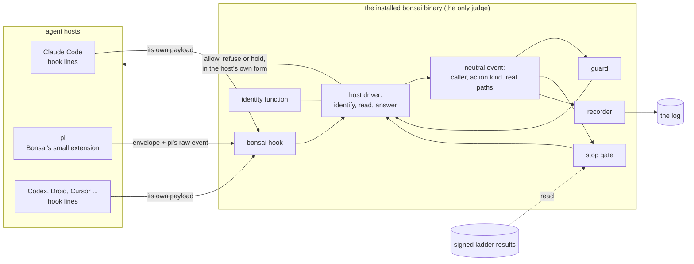

# Bonsai with any agent: the research (pi first)

- Status: research, for the director to read; not a plan and not approved. Later sessions plan from it.
- Written: 22 Oct 2026, task `T-5797` (run report `records/runs/R-2026-10-22-T-5797-any-agent-research.md`), by the
  orchestrator (Opus 5.5) with eleven research helpers and five live probes. Two fresh Opus verifiers read it, one for
  facts and one for security (section 11).
- Scope, on the director's word (22 Oct): any agent, pi first (other agents studied to test the design, not built
  for); the 1.0 question answered at the end with reasons (section 8); live tests in scratch only; the document here.
- How to read it: section 0 is the whole story in one page. Sections 2 to 5 are the evidence. Section 6 is the design.
  Sections 7 to 9 are what the director decides and in what order work could go. Grep the `## N.` headings; every
  claim names its source (a file and line, a link, a report's message id, or a probe), graded as in section 1.

## 0. In plain words

**What breaks under other agents, and what does not.** Bonsai's core already serves any agent: the formats, the
ladder, `check`, messages, asks, tasks and the log's vocabulary name no agent, and under pi the ladder and the proof
worked unchanged. What fails is everything where Bonsai meets the agent: its words do not reach the model (the block
sits in `CLAUDE.md` behind `@` imports, the skills are Claude plugins), nothing calls the guard, stop gate or recorder
(the hook lines exist only in Claude's settings), Bonsai cannot tell who is acting (it reads Claude's variables), and
the walls are Claude's own deny rules. That is about 11% of Bonsai's Go code, in 121 places, plus 21 lines in the packs
that tell the model to use Claude's tools.

**The root cause, in one sentence:** Bonsai reads missing evidence as the highest privilege. No Claude marker in the
environment means "a person", so pi's shell can run `bonsai update --yes --allow-exec`; no subagent id means "the
person's own session". Under Claude Code, which always sets both, that is right. Under any other agent it fails open.

**What the field looks like** (fourteen agents read, 22 Oct 2026). Most coding agents copied Claude Code's hook shape
(Codex, Droid, Copilot CLI, Kiro, Goose, Gemini); pi, OpenCode and Amp run in-process extensions instead. Most hooks
fail open by default. Three agents (Cursor, Devin, Copilot CLI) already run Claude's hook settings, so Bonsai's lines
will run under them by accident; Codex takes them once a person imports and trusts them. `AGENTS.md` and Agent Skills are nearly universal. researcher#7 found no project with a cross-agent stop gate or
proof ladder.

**What pi showed, live.** pi can host all of it: its stop hold reaches the model (ran in print and JSON modes; the same code path serves the terminal UI), and a 45-line extension
calling today's unchanged `bonsai` refused every protected write tried; every call, allowed or refused, took 6 to 13 ms. Two traps: an extension loaded
after the guard can rewrite a call the guard allowed, and pi waits on standard input when a script starts it.

**The fundamental fix: a host seam.** One neutral model of what happens in a session (events, and actions by kind:
read, write, edit, shell, spawn ...) that the guard, stop gate and recorder judge. A Go driver per agent reads that
agent's own payload, answers in its form, wires itself so it fails closed, delivers Bonsai's words in the files that
agent reads, renders the walls in its terms, and states what it can enforce. Defaults that stay safe: absence of
evidence is never privilege. Honesty: `bonsai status` says what holds under each agent. A floor: everything that can
be a command is one, so an agent with only a shell still gets the skills, the context and the proof. For pi, a tiny
extension shipped with the binary carries events and obeys; it judges nothing.

**Security.** With one OS user and no sandbox, nothing an agent-side hook does is a wall, under any agent: decision D
holds everywhere. A real wall is an OS sandbox around the agent's shell with Bonsai outside it as the only writer of its
records, and Claude Code and pi both already split that way. The proof (the ladder at a clean commit, rung 0, CI on the
exact commit) is the root of trust for every agent, because every agent's work ends as git commits.

**For 1.0:** no change of scope. Two small additions to rc.2: count the other agents' markers (`AI_AGENT` and the known
others) as an agent wherever person-only commands are refused, a tripwire that catches pi and others when they act in
good faith (a deliberate `env -u` still gets past it, and five hosts document no marker); and say plainly in the
README which agent 1.0 is built for. Then the host seam is the first part after 1.0 (section 8).

**What the director decides:** nine choices, D1 to D9 (section 7): when the work runs, shims in another language,
how far the walls go, how strong person proof is, how roles run on pi, where skills go, the second agent, the pack
texts, and whether a project may refuse tools no driver judges. The work after 1.0 falls into seven phases (section 9).

## 1. The question, and how it was answered

**The director's brief (22 Oct):** "currently bonsai is dependent on being used with claude code a lot, and it fails
when being used with other agentic systems ... we need to solve it at the fundamental level, use creativity wherever we
can, and security is always a core principle to keep in mind." The director now also uses pi (pi.dev), with a harness of
their own, and ran a trial of Bonsai under pi in scratch (`~/bonsai-checks/pi-trial/`: `FINDINGS.md` #0-#19,
`PI-ADAPTER.md`, `PI-PIECES.md`, each with a second reviewer's notes).

**What Bonsai's own design already says.** The spec puts Claude Code first and other agents later: "Claude Code first
(Q5 a): the parts marked Claude Code only get a thin adapter per agent later, on [the director's] word" (spec section
5); "Later, on [the director's] word: other agents and `AGENTS.md`" (spec section 2). The contract: "Formats name no agent, except fields
marked Claude Code only" (contract section 2.7). And decision D, the security stance this research tests: "guards are a
tripwire against accidents and the known cheats, not a wall against a same-user agent" (spec section 7).

**The evidence behind this document** (all on 22 Oct 2026):

| Source | Model | What it covered | Where its full text is |
|---|---|---|---|
| The pi trial | (the director's sessions) | Bonsai rc.1 under pi 1.4.0, step by step; 20 findings | `~/bonsai-checks/pi-trial/` |
| auditor | Sonnet 5.5 | Every Claude Code tie in Bonsai's Go code, by concern | message `M-2026-10-22-79095a89` (+ `-0bb7b366`) |
| auditor#2 | Sonnet 5.5 | Ties in the formats, contract, packs, docs; what each would cost to change | `M-2026-10-22-f7bbc3c9` |
| auditor#3 | Sonnet 5.5 | pi 1.4.0's extension lifecycle, from its source | `M-2026-10-22-f2123ac5` |
| auditor#4 | Sonnet 5.5 | pi's tools, paths, environment, loading and trust, sessions, sandbox; the director's harness | `M-2026-10-22-a8ac9080` |
| researcher | Sonnet 5.5 | Codex CLI, Gemini CLI, Copilot CLI against the host matrix | `M-2026-10-22-b4f04faf` |
| researcher#2 | Sonnet 5.5 | Cursor, Factory's Droid, OpenCode against the host matrix | `M-2026-10-22-053bfa71` |
| researcher#3 | Sonnet 5.5 | Amp, Goose, Cline, Kiro, Windsurf/Devin, Aider (shallow) | `M-2026-10-22-e08055c9` |
| researcher#4 | Sonnet 5.5 | AGENTS.md, Agent Skills, shared agent and plugin formats, agent markers | `M-2026-10-22-5e8f7007` |
| researcher#5 | Sonnet 5.5 | The Agent Client Protocol and OpenTelemetry as neutral layers | `M-2026-10-22-3ce2d917` |
| researcher#6 | Opus 5.5 | OS sandboxes and the trust boundary on Linux, WSL2, macOS, Windows; telling a person from an agent | `M-2026-10-22-b7f19b73` |
| researcher#7 | Sonnet 5.5 | Prior art: tools that already reach many agents | `M-2026-10-22-a85b1d5f` |
| Probes P1-P5 | Haiku 5.5 inside pi | Live runs of pi 1.4.0 in scratch | `~/bonsai-checks/T-5797/probes/` (logs in `out/`) |

Messages live in the main checkout's `.bonsai/local/messages/` for 30 days (`bonsai message --show <id>`); the
orchestrator's working notes, which quote every report's key lines, are `~/bonsai-checks/T-5797/notes-orchestrator.md`.
The host matrix every agent was read against (rows N1-N13: context, skills, pre-tool gate, stop gate, session start,
recorder, identity, config trust, walls, subagents, packaging, models, platforms) is
`~/bonsai-checks/T-5797/needs-matrix.md`.

**Grades.** *Ran*: observed in a live run here. *Pointed*: the line was opened and read. *Said*: a vendor's or a third
party's claim, not checked. *Inference*: reasoning, marked as such. Agent tools change monthly; every outside fact is
as of 22 Oct 2026.

## 2. Where Bonsai is tied to Claude Code today

### 2.1 The size of it

- **Go code** (auditor, pointed; counts ran): 283 non-test files, 72,874 lines. Wholly Claude-bound: 16 files, 6,589
  lines (9%); about 11% with the files that exist only to serve Claude's hook loop or `CLAUDE.md`. 121 coupling sites:
  39 a rename (a name or constant), 50 a shape (a data shape is Claude's), 32 structural (the logic assumes Claude's
  behaviour). 13 of 31 packages have no Claude dependency at all; 8 more have one to six lines.
- **Formats** (auditor#2, pointed): nothing a second agent needs forces a new major. 35 schema places name Claude: 28
  only in a description or example, 4 take an addition, 3 would need a major only if changed (`sessions.kind`
  `[session, subagent]`, `roles.kind` `[lead, helper]`, `workspace.never_edit`'s pattern that bars `( ) ~` for Claude's
  rule syntax), plus `lock.files.kind`, closed at `[pack, once, block, keys, kept]`, where `keys` means "entries in a
  JSON file". `log.agent` is an open string ("claude-code today"). Contract section 2.7's own rule is not kept: 94
  schema lines say Claude, 9 carry the "Claude Code only" mark.
- **The log's output is already neutral.** Its events (`session_start`, `prompt`, `tool_start`, `tool_end`, ...) and
  categories (`Read`, `Search`, `Edit`, `Write`, `Shell`, `Ladder`, `MCP`, `Agent`, `Web`, `Other`) name no agent (contract 8.2).
  Only the input side, Claude's eleven hook events mapped onto them (contract 8.3, `recorder/record.go:55-67`), is
  Claude's.
- **Packs** (auditor#2): 21 places tell the model to use a Claude tool or command (base 9, workflow 12): the Agent tool
  with `subagent_type`, `SendMessage`, `claude --agent workflow:orchestrator`, `claude -p --agent workflow:builder`,
  "never start Claude Code from your shell". All 29 skills' frontmatter holds only `name` and `description`, so the
  skills themselves are portable Agent Skills. Base's 149 deny rules are in Claude's rule syntax, though their targets
  already include pi's `~/.pi/agent/auth.json` and Codex's and Gemini's files.

### 2.2 The five concerns at the seam

Everything agent-specific sits at one seam between Bonsai's neutral core (formats, ladder, `check`, messages, asks,
lanes, tasks, the log's vocabulary) and the agent. It splits into five concerns. Under pi today, from the trial and this
research:

| Concern | What Bonsai needs | How Claude Code gives it today | Where in Bonsai (pointed) | Under pi today |
|---|---|---|---|---|
| **Delivery**: Bonsai's words reach the model | The block and its protocols, skills, roles, model tiers | The block in `CLAUDE.md` with `@` imports; packs as Claude plugins (`pack:skill`, `workflow:role`) | `engine/block.go:45,79,88`; `engine/plugins.go`; `engine/settings.go:542-610` | Not read: pi reads `AGENTS.md` first, one file a folder, no `@` (trial #1); skills only inside bare git repos (#4) |
| **Interception**: Bonsai sees and can stop actions | A guard before each tool call, a stop gate, a recorder, the opening context | Hook lines in `.claude/settings.json` that call `bonsai hook guard/stop/start/record` | `engine/settings.go:233-290`, `engine/hookline.go`, the one reader `hookin/payload.go`; decisions by Claude tool name in 14 files | Nothing runs (#6, #10, #12); fed a Claude-shaped payload by hand, the engine works (#14; probe P4) |
| **Identity**: who is acting | The project, the session, the agent and subagent, a person or an agent | `CLAUDE_PROJECT_DIR`, `CLAUDE_CODE_SESSION_ID`, `CLAUDE_CODE_CHILD_SESSION`, `agent_id`/`agent_type`, Claude's `subagents/agent-<id>.meta.json` | `hookin/hookin.go:40`; `asks/asks.go:33`; `cmd/bonsai/agent.go:42`; `guard/roles.go:420-486`; `hookin/spawnmeta.go`; `"claude-code"` hard-coded in 6 places | Person-only commands run from pi's shell as if a person typed them (#8); asks and ladder records have no session (#17) |
| **Containment**: walls that hold when interception fails | Secret files unreadable; Bonsai's records, its home and the agent's settings unwritable, by any route | Claude's own `permissions.deny`, which also stops simple shell routes (spec section 7) | `engine/settings.go:308-347` writes them; no Go code enforces them; the guard judges no `Read` and no shell write (`guard/shell.go:37-39`) | None: pi has no permission system at all (auditor#4, `docs/security.md`) |
| **Proof**: work is shown done | The ladder, rung 0, CI on the branch | Plain commands | `internal/ladder`, `internal/rung0`, CI | Works as is (#9, #11) |

### 2.3 The hardest ties

From the auditor's report, with one addition of this research's:

1. **The walls and the block-and-continue protocol are Claude Code's own engine, not Bonsai code.** Bonsai configures
   Claude's deny rules and trusts Claude to enforce them; it relies on exit 2, a timer under Claude's hook timeout,
   `onFailure: "block"`, a matcher regex and Claude's cap of eight stop holds (`hookin/frame.go`,
   `engine/settings.go:75-86,181-198`, `stopgate/stopgate.go:70-86`). Another agent needs another mechanism for each.
2. **Identity and roles.** The guard learns who calls only from Claude's `agent_id` and `agent_type`, Claude's spawn
   tools (`Agent`, `Task`, `SendMessage`, `Workflow`, `Skill`) and Claude's undocumented meta file; about 3,900 lines
   assume it (`guard/roles.go`, `skill.go`, `budget.go`, the `agents` package).
3. **The person-versus-agent marker.** Every person-only command (`--allow-exec`, `unlink`, a new base branch, looser
   checks, `settings set`, `labels attach/detach`; 8 call sites) is refused only because Claude sets
   `CLAUDE_CODE_CHILD_SESSION` in every process its tools start; `guard/shell_env.go` (355 lines) watches for a shell
   line that unsets it.
4. **Absence of evidence is read as the highest privilege, in two places** (this research's reading of the auditor's
   rows). No `CLAUDE_CODE_CHILD_SESSION` means "a person" (`cmd/bonsai/agent.go:42`). No `agent_id`, `agent_type` or
   `BONSAI_ROLE` means "the person's own session", the most privileged caller of the role rules
   (`guard/roles.go:422-424`). Both are sound under Claude Code, which always sets the evidence for its agents, and both
   fail open under any agent that does not. This is the root of the trial's #8, and it would be the root of a role
   bypass under any host without subagent ids.

### 2.4 Seams that already exist

The auditor found the code readier than the trial thought: every start of `claude` sits behind the `PluginCLI`
interface and an injected version function (`engine/plugins.go:100`, `cmd/bonsai/main.go:66-75`); `hookin` is the one
payload reader (only the guard, recorder, stop gate and `hook now` import it); the recorder's event table and the
guard's tool list are one table each (`recorder/record.go:55`, `engine/settings.go:142`); and the guard's shell and path
judges take a `Payload` struct, not Claude's JSON, so anything that fills that struct reaches them. The shell judge
(`guard/shell.go`, `shell_paths.go`, `shell_split.go`, `shell_words.go`: 5,272 lines) is neutral code; `shell_env.go`
beside it (355 lines) is Claude-bound. 64 fixture files recorded from Claude Code 2.1.300 sessions pin
the payload, transcript and subagent behaviour in tests.

## 3. The field: what agent hosts offer (October 2026)

Fourteen hosts read against the host matrix (rows N1-N13) by three researchers (researcher, #2 and #3), with #4 and #5
on the shared layers; all reading, nothing installed or run (message ids in section 1). Treat every cell as true on 22 Oct 2026 only: in the last five months
Windsurf became Devin Desktop (2 Jun 2026), Gemini CLI stopped serving individual users in favour of Antigravity CLI
(18 Jun 2026), OpenCode shipped a second major with an incompatible plugin API beside the first, Continue reached end
of life and Roo Code was archived.

### 3.1 The patterns

1. **The blocking pre-tool hook has converged on Claude Code's shape.** Codex (same event names, stdin keys, exit 2,
   `stop_hook_active`, Claude tool-name aliases), Droid (same events, exit 2, `permissionDecision`), Devin's CLI,
   Copilot CLI, Kiro, Goose and Gemini CLI (`BeforeTool`) take a command on stdin and block by exit code or JSON; Cursor
   has its own names but accepts Claude's. pi, OpenCode and Amp instead run in-process extensions in TypeScript or
   JavaScript. Aider has nothing.
2. **Fail open is the default nearly everywhere.** Codex on any hook error or timeout; Copilot CLI on timeout, even for
   an admin's hooks (closed on a crash); Cursor unless `failClosed: true`; Droid, Goose (unless `on_failure: "block"`),
   Cline, Devin, Cascade and Gemini on errors. Claude Code holds only because Bonsai's line ends `|| exit 2` with
   `onFailure: "block"` and Bonsai keeps its own timer under the hook's timeout (`hookin/frame.go`).
3. **A stop that can be refused is common but uneven.** Holds: Claude Code (host cap 8), Codex (no cap found), Droid (no
   cap), Copilot CLI (honours 8 in a row), Goose (a capped variable), Kiro's CLI V3, Amp (5), Gemini CLI (`AfterAgent`; a cap of about 100,
   inferred), pi (no cap). Re-prompts:
   Cursor (`followup_message`, cap 5). None: OpenCode (a proposal closed unmerged on 4 Oct 2026), Cline, Cascade, Aider.
4. **Subagent identity reaches hooks in few hosts.** Yes: Claude Code, Codex (`agent_id`, `agent_type`), Copilot CLI
   (`agentId`, `agentType`, `parentAgentId`), Cline's file hooks, OpenCode V2. No: Cursor (a staff-confirmed gap),
   Gemini, Goose; Droid undocumented; pi has no subagents of its own.
5. **Markers on the agent's shell exist but are not standard.** `AI_AGENT` is forming (set by Claude Code, as
   `claude-code_<version>_agent` on 2.1.308 (ran), pi and OpenCode V2; read by std-env); besides it `CODEX_THREAD_ID`,
   `GEMINI_CLI=1`, `CURSOR_AGENT=1`, `GOOSE_TERMINAL=1` with `AGENT=goose`, `OPENCODE=1` with `AGENT=1`. Copilot CLI,
   Droid, Kiro, Devin and Aider document none.
6. **`AGENTS.md` is nearly universal; imports are not.** Claude Code reads `AGENTS.md` only when no `CLAUDE.md` exists
   (v2.1.277, 18 Sep 2026). Only Claude Code (`@path`), Gemini, Copilot, Amp, Goose, Antigravity and Kiro (its own form)
   follow imports; Codex, OpenCode, Cursor and pi do
   not; Droid documents none.
7. **Skills are portable; their folder almost is.** `SKILL.md` is read by every host but Aider. `.agents/skills/` is the
   shared project folder (Codex, Gemini, Antigravity, Cursor, OpenCode, pi, Amp, VS Code's Copilot), but not Claude
   Code's (`.claude/skills/`, which Cursor, OpenCode, Amp, Copilot and Cline also read). Names are `[a-z0-9-]`, at most
   64, equal to the folder; nobody but Claude has a `pack:skill` namespace. Bonsai's 29 skills already fit the rule.
8. **Walls that also stop the shell come only from OS sandboxes:** Claude Code (deny rules on simple routes; its
   sandbox for more), Codex (OS-enforced deny globs; `.codex`, `.agents`, `.git` read-only), Droid (opt-in, wraps hooks
   too), Cursor (shell only, macOS and Linux), Copilot CLI (opt-in, off by default), Gemini CLI (its sandboxes, off by
   default), Kiro (opt-in), Devin Local. pi, OpenCode, Amp, Goose, Cline and Aider
   have none; Cursor's `.cursorignore` and Cline's `.clineignore` say outright they are no boundary.
9. **Four hosts run or import Claude Code's hook settings:** Cursor (third-party configs on by default; the CLI cannot
   turn it off), Devin's CLI (`read_config_from.claude` on by default), Copilot CLI (reads `.claude/settings.json`
   hooks, `CLAUDE.md`, `.claude/skills` and `.claude-plugin/`), and Codex (an importer). Bonsai's Claude lines will run
   under the first three with their own payloads, and under Codex once a person imports and trusts them (section 5.4,
   S3).
10. **Few hosts make a person trust a project's hooks.** Codex skips every non-managed hook until a person trusts it by
    its hash; Windsurf's Restricted Mode stops hooks; Gemini's "fingerprint" trust only warns. Managed layers are final
    in Codex (`requirements.toml`), Droid, Windsurf and Kiro.

### 3.2 The hosts, side by side

| Host (version, 22 Oct) | Context file, imports | Pre-tool gate; on failure | Stop | Subagent ids | Shell marker | Walls on the shell | Runs Claude's hooks |
|---|---|---|---|---|---|---|---|
| Claude Code 2.1.308 | `CLAUDE.md`, `@` | command hook, exit 2; closed with Bonsai's line | holds, cap 8 | yes | `CLAUDE_CODE_CHILD_SESSION`, `CLAUDECODE`, `AI_AGENT` | deny rules (simple routes); sandbox | n/a |
| pi 1.4.0 | `AGENTS.md`/`CLAUDE.md`, none | in-process `tool_call`; a throw blocks | holds (`agent_before_settle`), no cap | none native | `AI_AGENT=pi`, `PI_SESSION_ID` | none (example sandbox wraps bash only) | no |
| Codex CLI 0.163 | `AGENTS.md`, none | command hook, exit 2; open on error or timeout; trusted by hash first | holds, no cap found | yes | `CODEX_THREAD_ID` and kin | OS sandbox, deny globs | imports them |
| Copilot CLI 1.0.102 | `AGENTS.md`, `CLAUDE.md`, imports | command hook; closed on crash, open on timeout | holds, 8 | yes | none documented | opt-in OS sandbox for the shell (off by default); its file tools best-effort, no globs | yes |
| Gemini CLI 0.65 | `GEMINI.md` (`AGENTS.md` by setting), imports | `BeforeTool`; open on timeout or spawn error | `AfterAgent` (cap about 100, inferred) | no | `GEMINI_CLI=1` | its sandboxes (off by default) | no |
| Cursor 3.23 / CLI | rules, `AGENTS.md`, not inlined | `preToolUse`; open unless `failClosed`; Windows stdin BOM | re-prompts, cap 5 | no (staff-confirmed) | `CURSOR_AGENT=1` | sandbox, shell only, macOS and Linux | yes, by default |
| Droid 0.246 | `AGENTS.md`/`CLAUDE.md` | command hook, exit 2; open on other errors | holds, no cap | undocumented | none found | opt-in sandbox, wraps hooks | accepts Claude plugins |
| OpenCode 1.19 / 2.1 | `AGENTS.md` (V1 falls back to `CLAUDE.md`), none | in-process plugin; a throw blocks; no shim, no gate | none | V2 only | V2: `AI_AGENT=opencode`, `OPENCODE_SESSION_ID` | none | no |
| Amp | `AGENTS.md`, `@` | in-process `tool.call` | `agent.end` continue, cap 5 | not seen | `AGENT=amp` (said) | none | reads Claude plugin skills |
| Goose 1.55 | `AGENTS.md`, `.goosehints`, `@` | `PreToolUse`; open unless `on_failure: "block"` | holds, capped | no | `AGENT=goose`, `GOOSE_TERMINAL` | none | no |
| Cline 3.0 | rules, `AGENTS.md`, none | file hook `{"cancel": true}`; open | none | `agent_id`, parent | `CLINE_ACTIVE` (VS Code) | none | no |
| Kiro | steering, `AGENTS.md`, own form | `PreToolUse`, any non-zero blocks | CLI V3 holds | no | none | permission rules; opt-in sandbox | no |
| Devin Desktop / CLI | `AGENTS.md`, rules | Cascade `pre_*` exit 2; Devin CLI Claude-style; open on other errors | Cascade none; CLI unchecked | no | none | Devin Local: deny rules, sandbox | yes, by default |
| Aider 0.86 | none automatic | none | none | none | none | none | no |

### 3.3 Standards and shared layers

- **`AGENTS.md`**, stewarded by the Linux Foundation's Agentic AI Foundation (9 Dec 2025): the shared home for the
  block, read nearly everywhere; it defines no imports.
- **Agent Skills (`SKILL.md`)**: portable today; Bonsai's skills already meet its naming rule.
- **Agent Plugins 1.0.0**: a root `plugin.json` carrying skills and MCP servers only (no agents, hooks or rules), read
  by Codex, Copilot CLI and Cursor; not documented by Claude Code. A pack could add one beside `.claude-plugin/`
  (untested; section 10).
- **`AI_AGENT`**: the one marker standard forming; it marks "some agent", never "a person".
- **The Agent Client Protocol** and **OpenTelemetry**: neither can be Bonsai's seam (section 6.12).

### 3.4 Prior art, and what it teaches (researcher#7)

Instruction and skill syncers are a crowded, healthy field (Ruler, rulesync, Microsoft's APM, skillshare), and most
name pi as a target. Cross-agent hook libraries are young and small (speakeasy's agenthooks in Go and Checkmarx's in
the standard library, eight or nine agents each, neither pi). The projects that reach pi with something that matters
(cc-safety-net as a guard, Entire as a recorder, rulesync as a generator) all generate an in-process pi extension that
calls a binary. **researcher#7 found no project with a cross-agent stop gate or proof ladder** (the nearest, babysitter, loops over
each harness's own continue mechanism): that part of Bonsai has no peer it could find. The
lessons, each with its source in the report:

1. Files, hooks and sandboxes are three layers with three toolsets; say which one each guarantee lives in.
2. Share instructions and skills through `AGENTS.md` and Agent Skills; mind Claude Code's one-or-the-other rule.
3. Keep a Claude-shaped canonical model with per-host differences as data, and give every quirk a fixture.
4. State each host's fail mode; most fail open.
5. For in-process hosts the shim decides whether the guard exists: keep it tiny and generated, install it where
   headless runs load it, make it aware of nested agents, and notice a session with no guard event.
6. The stop gate is the least portable piece; the hard gate stays the landing rule and CI.
7. Whatever writes into an agent's configuration is an attack surface (symlinks at output paths; "an execution grant,
   not a preference", in Entire's words; Codex's trust by hash).
8. For records, hook events plus git are the portable core; transcript parsing is a treadmill.

## 4. pi in depth: the first target

pi 1.4.0 (`earendil-works/pi`, MIT, released 21 Oct 2026): a terminal coding agent whose extensions are TypeScript
modules running inside pi's own process. pi has no permission or deny system; its security page says it "does not ask
for approval before every tool call" and that watching, trust and review "do not create a security boundary"; it
recommends a container, VM or sandbox (auditor#4, `docs/security.md:3,7,16`).

### 4.1 What pi gives Bonsai, need by need

All pointed in pi's installed source and docs (auditors #3 and #4) unless marked ran.

| Need | pi's mechanism | How it behaves | Evidence |
|---|---|---|---|
| Pre-tool gate | `tool_call` handler returns `{block: true, reason}` | The model sees the reason as the call's error; a handler that throws blocks the call (fail closed); the handler has no timeout, so the guard must time-box itself | `types.d.ts:978-984,1089`; `runner.js:957-972`; P4 (ran) |
| Order of handlers | Load order | `-e` paths first, then the project's settings-listed and `.pi/extensions` (trusted only), the user's settings-listed and `~/.pi/agent/extensions`, then packages (project before user, in `packages` order), then built-ins | `resource-loader.js:409`; `package-manager.js:50-70,2124` |
| Who changes a call after the guard | Any later handler | `event.input` is one mutable object; "No re-validation is performed after mutation"; no final read-only stage; `tool_result.input` is the input as executed | `types.d.ts:978-984`; `agent-loop.js:497-537`; P2 (ran) |
| Parallel calls in one message | Sequential handlers | All `tool_call` handlers of one message run one after another and finish before any of its tools start | `agent-loop.js:419-459` |
| Nested calls (codemode, MCP) | Same `tool_call` | Calls a codemode script makes reach `tool_call` with `parentToolCallId`; MCP tools default to codemode exposure, so they arrive as nested calls | `extensions.md:261`; `agent-session.js:384-405` |
| Stop gate | `agent_before_settle` returns `{entries: [...event.entries, message], continue: true}` | The message becomes a user message the model answers, in interactive, `-p` and `--mode json` alike; no built-in cap; a handler that throws fails OPEN (settles); `continue` alone without a message does nothing; never called after Escape | `agent-session.js:1423-1589`; `messages.js:89-96`; `runner.js:775-805`; P1 (ran) |
| Session start and compaction | `session_start` (reasons startup, reload, new, resume, fork); `session_compact` | No `session_start` on compaction; a message from `before_agent_start` persists every run and is summarised away by compaction, while a system-prompt section survives | `types.d.ts:575-581,601-635`; `session-format.md:242,248` |
| Opening context | `before_agent_start` (a message, a system-prompt section) | Runs before the first model call, in `-p` too | `agent-session.js:1488-1529` |
| Session end | `session_shutdown` | Awaited on a normal end and SIGTERM in every mode, and SIGHUP off Windows; NOT on SIGINT in `-p`/json, nor on a crash | `print-mode.js:31-47,138-143`; P1 (ran) |
| Skills from outside the project | `resources_discover` returns `skillPaths` | Any folder, no trust check; names must match `[a-z0-9-]`, at most 64; on a clash the first found wins and extension paths come last | `resource-loader.js:323-348,613-623`; `skills.md:81,85` |
| A flag for named sessions | `pi.registerFlag` | Readable from `session_start` on, also in `-p`; a flag no loaded extension registered makes pi exit 1, so a launcher flag proves the extension loaded | `agent-session-services.js:27-45,112`; `main.js:745-754` |
| The person's `!` lines | `user_bash` | Interactive and RPC only; can block by returning a result | `interactive-mode.js:5828-5866` |
| Agent marker | `AI_AGENT=pi`, `PI_CODING_AGENT=true` | Set at pi's start, inherited by everything it starts (shell, `!` lines, MCP servers, subagent children); not set when pi is embedded through its SDK | `cli/setup.js:5-6`; P3 (ran) |
| Session id | `PI_SESSION_ID` (also `PI_SESSION_FILE`, `PI_MODEL`, `PI_PROVIDER`) | Only in the model's bash/powershell calls, not `!` lines; ids are UUID v7 by default but `--session-id` allows `.`, which Bonsai's log-file rule does not | `bash.js:136-154`; `session-manager.js:12-19` |
| Shell | `bash` (Git Bash on Windows), optional `powershell` | Spawned detached off Windows (`detached: process.platform !== "win32"`): no terminal, its own session; every call a new process | `bash.js:63-69`; P3 (ran) |
| Paths | The file tools rewrite paths before use | One leading `@` stripped, `~` expanded, `file://` read, Windows `/c/...` forms rewritten, then resolved against the session folder; lexical, no symlink resolution; the resolver is not exported | `utils/paths.js:59-87`; `path-utils.js:42-44` |
| Usage | Per assistant message | `input`, `output`, `cacheRead`, `cacheWrite`, cost and model in the session file and in `message_end` events | `session-format.md:89-95`; P1 (ran) |
| Loading and trust | User and project settings, `-e`, packages | In `-p`/json/rpc, project resources are skipped silently unless `--approve`, a saved yes or `defaultProjectTrust: "always"`. A trusted project's `.pi/settings.json` entry with the same package identity replaces a user package, and `extensions: []` loads none of it. `pi -ne`, `PI_CODING_AGENT_DIR` and editing `~/.pi/agent/settings.json` or `trust.json` turn any extension off | `project-trust.js:18-59`; `package-manager.js:1392-1431`; `docs/packages.md:94-125` |
| Subagents | None in pi itself | The director's harness starts a child `pi --mode json -p --no-session`, environment plus `PI_SUBAGENT` only: no parent id, one level deep, no resume; its agent files read `name, description, tools, model, thinking, extensions` (no `skills`, no `maxTurns`) | harness `extensions/subagent/index.ts:319-387,511`; `agents.ts:36-43` |
| OS sandbox | An example extension, `@anthropic-ai/sandbox-runtime` 0.0.26 | Wraps only `bash` and `!` lines, macOS and Linux; pi's read/write/edit stay unsandboxed; a project `.pi/sandbox.json`, read without trust, wins and can set `enabled: false` | `examples/extensions/sandbox/index.ts:108,214-256` |
| Telemetry | `pi-telemetry` | A contract library with no exporter, not wired into the coding agent: no use to a recorder | `pi-telemetry/README.md:3-15` |

### 4.2 The probes (ran, 22 Oct, pi 1.4.0, model claude-haiku-5-5, `~/bonsai-checks/T-5797/probes/`)

- **P1, the stop gate in `-p` and `--mode json`.** An extension held the first settle with a message ("BONSAI STOP
  GATE: you may not finish yet. Create the file stop-ok.txt ... then finish.") and `continue: true`. In both modes the
  model wrote the file as told, the second settle found it and let the run end. The hold shows in the JSON stream as an
  `entry_appended` event. A `session_shutdown` handler that waited 1.5 s and then wrote a file finished before pi
  exited, in both modes. The trial review's two unchecked points (does the message reach the model; does `continue`
  work in print mode) are settled: yes.
- **P2, handler order.** A guard extension loaded before a second extension that rewrote a write's path: the guard
  judged `{"path":"ok.txt"}`, the second extension changed it, and the file was written at the rewritten path. The
  guard's `tool_result` handler saw the executed path, so the change is visible after the fact. With the order
  reversed, the guard judged the rewritten path and blocked it. **A guard in pi must run last, and must compare
  `tool_result.input` with a copy of what it judged.**
- **P3, the environment.** pi's shell had `AI_AGENT=pi`, `PI_CODING_AGENT=true`, `PI_SESSION_ID`, `PI_MODEL`,
  `PI_PROVIDER`, no terminal, its own session, and the `pi` process as its parent. Because the probe's pi was started
  from a Claude Code session, the shell also held every `CLAUDE_*` variable of that outer session, a messaging token
  among them. **Markers pile up in nested agents, and a host's secrets reach the agents nested in it** (the values were seen
  live and are kept, without secrets, only in the orchestrator's notes; `out/env.stdout` holds just the model's reply).
- **P4, a prototype guard.** A 45-line extension (`ext/bonsai-pi-proto.ts`) turned each pi call into a Claude-shaped
  payload and called the installed rc.1 `bonsai hook guard`, unchanged, in the trial project with its scratch home.
  An ordinary write was allowed; `edit bonsai.yaml` and `edit @bonsai.yaml` were refused (person-only); a write into
  `.bonsai/local/` was refused (Bonsai's files); `rm bonsai.yaml` was refused (the delete check). 6 to 13 ms a call.
  The model quoted each refusal and did not retry. The guard's records landed in the pi session's own log file, all
  labelled `agent: "claude-code"`. The first attempt hung for 300 s: **`pi -p` reads standard input when it is not a
  terminal, so anything that starts pi must close it.** (The prototype forges Claude's payload, which the design in
  section 6 rejects; it shows the engine is ready, nothing more.)
- **P5, pi's compile cache** (with `TMPDIR` and `JITI_RESPECT_TMPDIR_ENV=1` pointing the cache into scratch, so the
  real `/tmp/jiti/` was not touched). A TypeScript extension that logs "ORIGINAL" ran once and left a compiled copy in
  the cache; the copy was edited to log "TAMPERED"; on the next start, with the source unchanged, **pi ran the edited
  copy**. A plain `.mjs` extension left no cache file. So code written into the cache now runs inside pi later, beside
  Bonsai's extension, and the default cache (`/tmp/jiti/`) is writable by the agent's own shell, sandbox or not
  (pattern A leaves temp writable). Bonsai's extension avoids the cache by shipping as plain JavaScript; every
  TypeScript extension the person loads stays exposed unless the cache is off (`JITI_FS_CACHE=false`, a slower start)
  or walled.

### 4.3 pi-specific risks this research found

1. **A later extension can change a call the guard allowed** (P2). Mitigation: Bonsai's package is the last entry of
   the user's `packages`; its `tool_result` handler compares the executed input with its judged copy and records a
   guard fault on any change; ask pi upstream for a final read-only stage.
2. **A trusted project can unload a user package** with a `.pi/settings.json` entry of the same identity
   (`extensions: []`). Mitigation: `.pi/settings.json` and `.pi/extensions/**` on Bonsai's never-granted floor; a
   `check` finding when the project's settings name Bonsai's package.
3. **pi runs bare with one flag or variable**: `pi -ne`, `PI_CODING_AGENT_DIR=...`, an edited user `settings.json` or
   `trust.json`. No extension can stop this; Bonsai can only notice (section 6.7, the unhooked-session finding) and, for
   named sessions, refuse to start without its flag.
4. **pi's sandbox example is switched off by a project file it reads without trust** (`.pi/sandbox.json`,
   `enabled: false`), and its sandboxed shell can write that file (researcher#6).
5. **The stop gate fails open on any handler error**, and pi has no cap: Bonsai's extension must wrap its handler,
   count an error as a hold, and leave the cap to Bonsai's own records.
6. **Session ids with a `.`** would make every payload a fault under Bonsai's log-file rule, so the guard would block
   everything: the reader must map them.
7. **Code that runs later from a writable place:** pi runs extensions from a user-writable compile cache
   (`/tmp/jiti/`), and runs an edited copy there as is (P5); it also auto-loads `~/.pi/agent/extensions/`, which pi's
   own write tool can reach outside any bash sandbox (security verifier; S14).
8. **The stop hold can be undone by another handler:** `continue` is last-writer-wins and invalid entries from any
   settle handler end the run (`runner.js:776,778,805`).

### 4.4 Corrections to the trial's documents

- `PI-ADAPTER.md`'s "parity" claim was already corrected by its reviewer (#19): Claude's deny rules stop shell routes to
  walled paths; pi stops none.
- "Skip when the person pressed Escape": pi never calls `agent_before_settle` after Escape (auditor#3); skipping on
  `outcome: "error"` is the case that matters.
- "[the director's harness] or a trusted project extension can change a call after the guard": project extensions load *before* user
  packages, so the guard sees their changes; only handlers loaded after it (later packages, built-ins) can change a
  call afterwards (auditor#3).
- The trial's open question "does `continue: true` work in print mode": yes (P1).

## 5. The security model

### 5.1 Who Bonsai defends against

Four kinds of trouble, from the agent's side. Decision D scopes Bonsai's guards to the first two; this research asks
what it would take to reach the others, under any agent.

| Level | What it is | Example | Stopped by |
|---|---|---|---|
| A1 Accident | The agent means well and slips | An edit of `bonsai.yaml` meant for another file; `rm -rf` on the wrong folder | Tripwires (the guard), proof |
| A2 Known cheat | The agent games its checks to look done | Weakening a test, writing its own green ladder result, loosening a floor | Tripwires, rung 0, the landing rule, CI |
| A3 Steered agent | The agent follows hostile text it read (prompt injection from a file, a page, a dependency) | "Run this to fix the build" that reads `~/.ssh` or rewrites the agent's settings | Walls (an OS sandbox), secrets out of reach, proof |
| A4 Hostile agent | The agent itself works against the person, as the same OS user | Unhooks itself, forges records, escapes through anything the user can run | Only an OS boundary plus proof the machine cannot forge (CI) |

### 5.2 The finding: the boundary is the harness, not the user

researcher#6 (Opus; pointed and ran, `M-2026-10-22-b7f19b73`):

- **With one OS user and no sandbox there is no wall.** Whatever Bonsai can write, the agent can write; decision D
  stays right there, under every agent.
- **A wall needs an OS sandbox around the agent's tool processes, with Bonsai's trusted writer outside it.** Two agents
  already split this way: Claude Code's hooks run outside its Bash sandbox ("with your full access"), and pi's
  extensions run in pi's own process while its sandbox wraps only `bash`.
- **Every OS can confine a child without admin rights:** Landlock or bubblewrap on Linux and WSL2, Seatbelt on macOS, a
  write-restricted token, low integrity or an AppContainer on Windows. Windows' strong form (a separate local account)
  needs an administrator once; Windows Sandbox is not on Home.
- **Landlock fits Bonsai's rules:** Go's standard library can apply it (`syscall.AllThreadsSyscall` with syscalls 444
  to 446; Bonsai already builds with cgo off). Its limit: it only adds rights to whole trees, so `.bonsai/local/` cannot
  be carved out of a writable checkout. This machine: Landlock active, ABI 7 (ran: a read-only `landlock_create_ruleset` version query by the orchestrator, 22 Oct); AppArmor off; unprivileged user
  namespaces allowed; bubblewrap 0.6.1 installed; socat not; `/usr/local/bin/bonsai` owned by root, mode 0755.
- **Not recommended:** a separate OS user with a setuid helper, or an AppArmor profile per binary. Neither works beside
  `no_new_privs`, which every sandbox sets; WSL's interop reaches root around both (`wsl.exe -u root`, inferred, not
  probed); Go had a setuid CVE (CVE-2023-29403).
- **Escapes from any same-user sandbox:** WSL interop (`/run/WSL/2_interop` is a world-writable socket here) and
  `/mnt/c` (the Windows Startup folder, `.wslconfig`); Windows "surrogate spawn" (Task Scheduler, COM, BITS); macOS
  Apple Events; files written now that run later outside the sandbox (git hooks and config, shell rc files, the
  harness's own settings).

### 5.3 Telling a person from an agent

| Signal | Can the agent fake it? | Source |
|---|---|---|
| An environment marker (`CLAUDE_CODE_CHILD_SESSION`, `AI_AGENT`, ...) | Yes: set, removed (`env -u`), or inherited from an outer agent (P3) | researcher#6; P3 |
| A terminal on stdin | Yes: `script`, `expect` or any pty; and Cursor's and Gemini's shells may run in a pty anyway (inference) | `pty(7)` |
| Process ancestry (a known agent among the parents) | Mostly no, but a double fork re-parents a process away from the agent (`setsid`, `nohup`, `systemd-run --user`), and in an editor the person's terminal shares the agent's parents (inference) | this research |
| A code shown on the person's terminal | Partly; pi's shell has no terminal (P3); for Claude Code unchecked | researcher#6 |
| `sudo -k <cmd>` | No, unless NOPASSWD, or WSL interop root | sudoers docs |
| Windows Administrator protection (Hello on every elevation) | No; off by default, Windows 11 with the Aug 2026 update | Microsoft Learn, 13 Oct 2026 |
| A FIDO key touch (`ed25519-sk`) | No | OpenSSH 8.2 notes |
| Being outside the agent's sandbox | No, while the sandbox has no escape | inference |

**What follows:** under a sandbox, a person-only act writes paths the sandbox denies, so only a process outside it can
do it, and Bonsai needs no other check. Without a sandbox, the real proofs are opt-in ceremonies (`sudo -k`, Hello, a
FIDO touch); markers, terminals and ancestry stay tripwires. Tripwires still matter: they catch A1 and A2, which is most
of what happens. **But today's tripwire fails open for every agent but Claude Code** (section 2.3, item 4).

### 5.4 Attack paths this research found

Each is a way Bonsai's protection is lost under some agent today, or would be under a naive adapter.

| # | Path | Where | Severity | Mitigation (section 6) |
|---|---|---|---|---|
| S1 | A non-Claude agent's shell runs person-only commands (`update --yes --allow-exec`, `unlink --yes`, accept looser checks) | Every non-Claude host, today (trial #8) | High | Every known marker and CLI-agent ancestry count as an agent (a tripwire; a sandbox or an OS ceremony for proof) (6.7; section 8 for rc.2) |
| S2 | No subagent id reads as "the person's own session", the most privileged role caller | Any host without subagent ids (Cursor's tool hooks carry none, staff-confirmed; Droid undocumented) | High once roles run there | A driver that cannot tell callers apart marks role rules advisory and never grants the person's rights (6.7) |
| S3 | Accidental host: another agent runs Bonsai's Claude hook lines with its own payload or tool names | Cursor, Devin and Copilot CLI read `.claude/settings.json` hooks; Codex imports them (section 3.1, item 9) | Medium: a Claude-shaped payload naming an unknown tool passes unjudged; a foreign shape blocks every call (unchecked which) | Readers tell the host from the payload and environment; a judged-looking call from an unknown host is refused, not allowed (6.3) |
| S4 | Other code in the host rewrites a call after the guard allowed it | pi (P2), including code loaded before the guard that changes and restores the shared input; Claude Code (`updatedInput`, parallel hooks); Cursor `updated_input`, OpenCode mutable args, Droid `updatedInput` | Medium | Guard last; compare executed input with the judged copy (catches later handlers, not a blinded change); ask hosts for a frozen judged input (6.6) |
| S5 | The agent unloads or reconfigures the guard through a settings file it can write | pi project packages, `.pi/sandbox.json`; Cursor reloads `hooks.json` live; OpenCode has no trust step | High | Each host's wiring files on the never-granted floor; shell-write tripwire; under a sandbox, write-denied (6.10) |
| S6 | The host fails open: a missing `bonsai`, a timeout or a parse error lets the call through | Codex (errors and timeouts), Copilot (timeouts, even preToolUse), Cursor (unless `failClosed`), Gemini (timeouts, spawn errors), Droid, Goose, Cline, Devin, Cascade; Cursor on Windows prepends a BOM to stdin | High | Fail closed is built into each host's hook line, never trusted to the host (6.6) |
| S7 | Walls missing: secret files readable, Bonsai's records writable through the shell | pi, OpenCode, Amp, Goose, Cline, Aider; Cursor's `.cursorignore` does not stop the shell | High for A3 | The guard judges walls on file tools for every host; a shell tripwire on walled names; a sandbox where the host has one (6.8) |
| S8 | A forged ladder result passes the local stop gate | Every host without a sandbox | Medium (CI catches it at landing) | Results written only by Bonsai outside the sandbox and signed; CI is the proof (6.9) |
| S9 | Nested agents inherit the outer agent's markers and secrets | Any host started from another (P3) | Medium | Identity reads the innermost host; walls include the environment (an env scrub) (6.7, 6.8) |
| S10 | pi started bare (`-ne`, `PI_CODING_AGENT_DIR`) or Claude with hooks off | Every host | Medium | Cannot be prevented; the unhooked-session finding notices it (6.7) |
| S11 | CI changed by the branch it judges; agents act on GitHub as the director's admin account | Bonsai's own repo | Medium | The landing rule refuses branches that touch `.github/workflows/` outside an approved task; a lower-privilege GitHub identity for agents (section 10) |
| S12 | A config writer follows a symlink planted at its output path | Every renderer that writes host files | Medium | Refuse to write through a symlink (prior art: rulesync, Entire) (6.10) |
| S13 | Tools no driver judges write files: MCP servers and tools that extensions register run outside the shell sandbox and are recorded, not judged | Every host with MCP or extension tools (pi's codemode reaches MCP tools as nested calls) | High for A3 | A strict mode that refuses tools the project does not name; pattern A's wall claimed for the shell route only (6.6, 6.8) |
| S14 | Code written now that the host runs later: a host's transpile or plugin cache, its user extension folder, git hooks, shell rc files | pi's `/tmp/jiti/` cache (ran: a rewritten copy runs, P5) and `~/.pi/agent/extensions/` (auto-loaded); every host's equivalents | High | Bonsai's pi extension shipped as plain JavaScript (no cache, P5); the cache off (`JITI_FS_CACHE=false`) or walled for the person's other extensions; walls on the whole user wiring (6.10) |

### 5.5 The layers, recommended

From researcher#6's pattern A plus E, and the prior art (researcher#7):

1. **Proof out of band** (every host, already in place): the ladder at a clean HEAD, rung 0 against the task's grants,
   CI green on the exact commit before `main` moves. This is the trust root. It works the same under every agent
   because every agent's work ends as git commits.
2. **Tripwires in the host** (every host that has hooks or extensions): the guard, the stop gate, the recorder, the
   opening context, each through a per-host driver. For A1 and A2.
3. **Walls under the host** (where an OS sandbox is on): the host's own shell sandbox, configured by Bonsai with its
   walls; Bonsai's own rungs in a sandbox of Bonsai's (to be specified and probed: 6.8); Bonsai's hook, outside the
   sandbox, the only writer of its records. A wall for the shell route. For A3 only where the project also allows no
   unjudged tool that writes (S13), and for A4 only as far as the sandbox and its escapes allow (5.2).
4. **Person-only acts**: outside the sandbox where there is one; otherwise a tripwire (markers, CLI-agent ancestry) and,
   on the director's choice, an OS ceremony.

## 6. The design: Bonsai with any agent

### 6.1 The reframe

Bonsai's guarantees sit at two layers. **At the git layer** (the ladder at a clean HEAD, rung 0 against the task's
grants, CI on the exact commit, the landing rule) they already hold for every agent, because every agent's work ends as
commits; the trial confirmed the ladder and proof work unchanged under pi (#9, #11). **At the host layer** (what the
model reads, what it may do, when it may stop, what is recorded) Bonsai today speaks only Claude Code. So "Bonsai fails
under other agents" is precisely: the host layer has one driver, and its defaults assume that driver. The fundamental
fix is not an adapter beside the Claude code; it is a **host seam**: one neutral model of what Bonsai needs from any
host, drivers that fill it per host, and defaults that stay safe when a host gives less.

### 6.2 Principles

1. **One engine decides.** Every allow, deny, hold and record is the installed binary's. Anything in a host's language
   (a pi or OpenCode extension) only carries the host's event to the binary, waits, and obeys.
2. **Raw in, judged in Go.** A host's own payload reaches Bonsai untouched (inside a thin envelope where the host has
   no command hooks). The host's tool table, path rules and answer format live in a Go driver, under Bonsai's tests and
   fuzzers. No host ever forges another's payload (this research's own prototype did, only to show the engine is ready; section 4.2, P4).
3. **Absence of evidence is never privilege.** Who is acting must be shown where a host can show it (caller ids). An
   unknown caller gets the least rights; an unknown host's call to a judged kind of tool is refused, not allowed
   (today's two exceptions: section 2.3, item 4). Where nothing can show it (a person at a terminal, without a sandbox),
   Bonsai refuses on any sign of an agent and says plainly that this is a tripwire (6.7).
4. **Fail closed is built into the wiring line,** never trusted to the host (most hosts fail open: section 5.4, S6).
5. **Say what holds.** Each driver declares, per host version, what it enforces; `bonsai status` and `check` show it
   per project. No silent parity.
6. **The proof is the root of trust.** Host-side machinery is early feedback and accident prevention; nothing that
   matters outside the machine rests on it alone.
7. **The shell is the universal floor.** Everything that can be a command is one, so an agent with nothing but a shell
   still gets the formats, the skills, the opening context, the ladder, messages and asks.
8. **Neutral content, per-host rendering.** Packs say what to do; Bonsai renders how, per host (the contract's own rule,
   section 2.7).
9. **Bonsai protects its wiring on every host,** not only Claude's.
10. **Host knowledge is data with fixtures.** Adding a host is a driver, a table and recorded payloads, not a rewrite;
    each driver names the host versions it was proved on (prior art: speakeasy's agenthooks keeps "Claude-shaped
    semantics with typed extensions" and a quirk registry that "doubles as the conformance-test plan", researcher#7).

### 6.3 The host driver

A Go package (`internal/hosts`, a sketch) with one driver per host.

Each driver does seven jobs:

| Job | What it does | Claude Code today | pi |
|---|---|---|---|
| Identify | From the environment and the process tree: is this process under this host, and is it the innermost one | `CLAUDE_CODE_CHILD_SESSION`, `AI_AGENT=claude-code_...` (not `CLAUDECODE`, which editor terminals carry too) | `AI_AGENT=pi`, `PI_CODING_AGENT`, the `pi` parent (P3) |
| Read | The host's payload to one neutral event (below) | `hookin/payload.go`, as is | pi's `tool_call` event inside the envelope; pi's path rules in Go |
| Answer | Bonsai's decision to the host's form | exit 2 and stderr | the shim returns `{block, reason}` |
| Wire | What makes the host call Bonsai, with fail-closed built in | hook lines in `.claude/settings.json` | the shim's place in the user's pi `packages`, last |
| Deliver | Context file, skills, roles, model tiers | `CLAUDE.md`, plugins | `AGENTS.md` (or `CLAUDE.md`), `resources_discover`, a role flag and tool |
| Wall | Bonsai's walls in the host's own terms | `permissions.deny` | none native: the guard, plus a sandbox config |
| Profile | What it enforces, per host version (6.4) | measured on 2.1.294-2.1.300 (the fixtures) | probed on 1.4.0 (4.2) |

**The neutral event.** What the guard, stop gate and recorder judge, instead of Claude's tool names:

- `event`: start, prompt, tool.before, tool.after, tool.fail, stop, subagent.start, subagent.stop, compact, end.
- `host`, `host_version`, `session`, `project` (the folder the session started in, fixed at start), `cwd`.
- `caller`: `person-session`, `subagent` (with id, type, parent) or `unknown`; never inferred from a missing field.
- `action` for tool events: a **kind** (`read`, `search`, `write`, `edit`, `shell`, `spawn`, `resume`, `message`, `web`,
  `mcp`, `ask`, `other`), the host's own tool name, the **paths the host will really touch** (resolved by the host's
  rules: pi's `@` and `~`, Claude's backslashes on Windows), the command, the content or edits, the spawn's role and
  prompt.
- `raw`: the host's payload, kept for the record's hash and for faults.

The guard's rules move from "tool is `Edit` or `MultiEdit`" to "kind is `edit`". The auditor counted 19 tool names
compared in 14 files; that refactor is the bulk of the Go work, and the Claude driver keeps today's behaviour byte for
byte (its 64 recorded fixtures are the test).

**The envelope, for hosts with no command hooks** (pi, OpenCode, Amp): `bonsai.hook/1`, a new format carrying only what
the host's event lacks: `format`, `host`, `host_version`, the host's own event name, `project`, `session`, caller ids,
`usage` where the host gives it per event, and `raw`, the host's event object as the host gave it. Command-hook hosts
(Claude Code, Droid, Cursor, Kiro, Goose, Devin, and others in section 3) need no envelope: their line names the host,
`bonsai hook guard --host droid`, and the driver reads the host's own stdin.

**Accidental hosts.** Cursor, Devin and Copilot CLI run the hook lines they find in `.claude/settings.json`, and Codex
imports them (section 3.1, item 9). Each driver checks that the caller is its host (Cursor sets `CURSOR_*` variables and
sends `conversation_id`; Devin sets `DEVIN_PROJECT_DIR`; Codex sets `CODEX_THREAD_ID`); a Claude line called by another host refuses judged kinds with a next step ("Bonsai is not wired
for Cursor in this project: `bonsai update` with `agents: [cursor]`"). Today the outcome depends on the payload: one
that is not Claude-shaped, or faults, blocks every call (`internal/guard/hook.go:270-278`), and a Claude-shaped one that
names a tool Bonsai does not know passes unjudged (`internal/guard/rule.go:319`). Which one each of these hosts
produces is unchecked (section 10).

### 6.4 Say what holds: the profile and the assurance

Each driver states, per protection, **enforced** (Bonsai's decision is final for the model's own calls on that route),
**tripwire** (holds for accidents and known cheats, not against a determined agent), **advisory** (the model is told;
nothing checks) or **absent**. "Enforced" never covers other code loaded into the host: a user's Claude Code mod can
approve past a project's hook (spec section 7), and any pi extension loaded before Bonsai's shares the call object and
can change it while Bonsai waits on the binary, then restore it before Bonsai's after-check (security verifier,
`agent-session.js:337,356`, `runner.js:902`). Against such code every host's guard is a tripwire, as decision D says. `bonsai status --json` gains a `hosts` list (each wired host, its version, whether its wiring is loaded, its
profile); `bonsai check` warns where a pack relies on something a wired host cannot give (roles declared, but the host
has no subagent ids: "roles are advisory under cursor").

The profiles as this research finds them (wired as section 6 proposes; where a host is not yet researched, see
section 3):

| Protection | Claude Code | pi (with Bonsai's extension) | Codex | Droid | Cursor | OpenCode | Shell only (Aider, unhooked) |
|---|---|---|---|---|---|---|---|
| Guard on file-tool writes | enforced | enforced (last handler; S4) | enforced once a person trusts the hook's hash; hosted tools unhooked | enforced (exit 2) | enforced if `failClosed` | enforced (throw) | absent |
| Guard on shell deletes and `bonsai` commands | tripwire | tripwire | tripwire | tripwire | tripwire | tripwire | absent |
| Secret reads on file tools | enforced (deny rules) | enforced (new: the guard judges `read`) | enforced (sandbox deny globs) | enforced (sandbox `denyRead`, opt-in) | enforced (CLI permissions) | enforced (permission rules) | absent |
| Walls on the shell route | tripwire (deny rules parse simple routes); wall with its sandbox | wall only with a sandbox; tripwire (new shell-word check) | wall with its sandbox (OS-enforced deny globs) | wall with its sandbox | wall with its sandbox (macOS, Linux) | tripwire only | absent |
| Stop gate | holds, host cap 8 | holds, Bonsai's cap | holds, Bonsai's cap | holds, Bonsai's cap | re-prompts, cap 5 | none: red end recorded | none |
| Recorder | full | full (events and usage per message) | Claude-like events | no tool-failure or subagent-start event | full but no tokens in hooks | from plugin events | Bonsai's own commands only |
| Session id | yes | yes | yes | yes | yes | yes | from `AI_AGENT`-style variables if any |
| Subagent identity (roles) | yes | yes, through Bonsai's own role tool | yes | undocumented | no (staff-confirmed gap) | V2 only | absent |
| Person-only commands | tripwire (marker) | tripwire (marker, ancestry) | tripwire (`CODEX_*`) | tripwire | tripwire (`CURSOR_AGENT`) | tripwire (V2 marker) | tripwire (CLI-agent ancestry) |
| Fails closed | yes (line and `onFailure`) | yes (`tool_call`); stop wrapped | with the line's `|| exit 2` and Bonsai's timer | with the line's `|| exit 2` | with `failClosed` | throw blocks; a shim that fails to load leaves none | n/a |
| Wiring protected | yes (`.claude/**` never granted) | after 6.10 | `.codex` read-only under its sandbox; after 6.10 | after 6.10 | after 6.10 (live reload) | after 6.10 | n/a |

The rows are this research's reading of each host's documented behaviour (researchers #2, #3; auditors #3, #4), not
yet measured with Bonsai wired in; each driver's fixtures and a conformance run (6.11) would measure them.

### 6.5 Delivery: Bonsai's words reach any model

- **The block goes into the file each host reads first, and Bonsai never creates a file that hides one a host reads
  today.** pi reads the first of `AGENTS.override.md`, `AGENTS.md`, `CLAUDE.md` in each folder; Claude Code reads
  `AGENTS.md` only when there is no `CLAUDE.md` (v2.1.277 on); OpenCode V2 reads only `AGENTS.md`; Droid reads both
  names; Cursor reads `AGENTS.md` and rule files. So: in a project with neither file, the block lives in `AGENTS.md` and
  `CLAUDE.md` holds `@AGENTS.md`; in a project with only `CLAUDE.md`, the block stays there (pi then reads it too);
  with both, the block goes in `AGENTS.md` and `CLAUDE.md` imports it.
- **Every import is also a plain line.** Next to `@records/protocols/session-start.md`, the block writes "Read
  `records/protocols/session-start.md` in full before anything else." Claude Code inlines the import; every other host
  (pi, Cursor and OpenCode do not follow `@`; Droid documents none) reads the file when told.
- **The opening context through the host's own channel**, where it has one: Claude's `SessionStart`; pi's
  `before_agent_start` as a system-prompt section (it survives compaction; a message does not) and again on
  `session_compact`; Droid's `SessionStart` (covers resume and compaction); OpenCode's per-request system transform;
  Cursor's rule file (its `additional_context` had a staff-confirmed drop bug). And on every host `bonsai status
  --active` and a new `bonsai context` print it on demand.
- **Skills: one pinned copy, many readers.** Bonsai writes each pinned pack's skills, read-only, into its home (a
  sketch: `~/.bonsai/packs/<pack>@<commit>/skills/<pack>-<skill>/SKILL.md`), with the frontmatter name flattened to
  `pack-skill` (the Agent Skills naming rule: lowercase, digits, hyphens; every host but Claude enforces or warns on
  it) and the body byte for byte. Claude keeps its plugins. pi's extension hands the folder to pi with `skillPaths`.
  Hosts that only scan fixed folders get them through those folders, which is the director's choice (section 7, D6).
  Every host can run `bonsai skill <pack:skill>` (new) to print one. The block maps names in one line: "a skill named
  `pack:skill` here is `pack-skill` on this agent." The home copies steer every later session, so they are write-walled
  and `bonsai check` compares them with the pinned commit.
- **Roles: neutral files, per-host starts.** A role stays one file in its pack (name, description, tier, skills, max
  turns). Bonsai renders it per host: Claude plugin agents as today; for pi, Bonsai's extension registers a
  `--bonsai-role <role>` flag (prompt, model and skills applied at session start) and a `bonsai_role` tool that starts
  or resumes `pi --mode json -p --bonsai-role <role> --session-id <agent id>` with the brief's id, the task and the
  parent's ids in its environment (the trial reviewer's design; it needs nothing from the director's harness, whose
  children are one level deep with no parent id and no resume). Droid has custom droids and Cursor and OpenCode have
  agent files; each driver renders to them.
- **Model tiers, not model names.** Packs say deep, standard, fast and visual (the workflow pack's own words: "deep
  (`opus`)"); a machine setting maps each tier per host. On pi, Bonsai's extension can register virtual models
  (`bonsai/deep`) so role files never change when the mapping does. The recorder writes the real model.
- **Pack texts say what, the block says how.** The 21 Claude-mechanics lines become actions ("start the builder role
  with the brief's id in its prompt"; "resume the same agent with the newer brief's id"), and Bonsai renders one short
  "on this agent" table into the block (Claude: the Agent tool, `SendMessage`, `claude --agent`; pi: `bonsai_role`,
  its resume, `pi --bonsai-role`).

### 6.6 Interception: the guard, the stop gate, the recorder

- **The guard** judges the neutral action. New judged kinds for every host: `read` against the read walls (today only
  Claude's deny rules stop secret reads), and the shell-word tripwire (6.8). Unknown tool of a known host: recorded,
  not judged, as today; **or, in a strict mode the project switches on, refused unless the project names it** (S13:
  MCP servers and extension tools write files outside every check). Any call from an unknown host to a line Bonsai
  wired for another: refused. A start of any known agent host from an agent's shell (`claude`, `pi`, `codex`,
  `gemini`, `opencode`, `droid` ...) is refused under roles, as `claude` alone is today (`guard/rolecmds.go:109`): such
  a session carries no caller id.
- **Fail closed per host.** Each driver's wiring line ends in its host's block form: Claude's `|| exit 2` and
  `onFailure: "block"`; Cursor's `failClosed: true`; Cline's `{"cancel": true}`; Goose's `on_failure: "block"`. For
  in-process hosts the extension's `tool_call` handler time-boxes the binary (10 s) and blocks on anything but a clean
  allow; a missing binary, a crash, a timeout or an unreadable answer is a block.
- **The guard runs last and checks after.** On pi, Bonsai's package is the last entry of the user's `packages`; its
  `tool_result` handler compares the executed input with a deep copy of what it judged and records a guard fault on any
  difference. The same check fits any host that lets later hooks rewrite input, Claude Code included (its hooks can
  return `updatedInput`, and matching hooks run in parallel). **It catches a rewrite by a later handler, not a blinded
  one:** code loaded before Bonsai's holds the same object and can change it during the guard's wait and change it back
  before the check (6.4). The real fix is upstream: a frozen copy of the judged input for execution (pi), or a final
  read-only stage; Bonsai can ask for it.
- **The stop gate** keeps its rule (a named task needs a green, clean ladder result) and learns three host classes:
  **holds** (Claude Code, Codex, Copilot CLI, Droid, pi, Goose, Kiro, Amp, Gemini CLI: the stop is refused and the
  reason sent back), **re-prompts**
  (Cursor's `followup_message`), and **none** (OpenCode, Cline, Cascade, Aider), where the red end is recorded, shown at
  the next session's start, and refused at landing. **The cap is Bonsai's:** it counts its own stop records for the
  session and, after eight holds in a row with no tool call between, lets go with a recorded rule (`stop-cap`), so no
  host loops forever and the decision is in the log. On pi the handler is wrapped (an error counts as a hold), keeps
  the entries earlier handlers proposed, and must be the last settle handler too: a later handler's `continue: false`
  cancels Bonsai's hold, and invalid entries from any handler end the run without it (`runner.js:776,778,805`).
- **The recorder** writes the same neutral records from each driver's event table; `agent` is the host, not
  `"claude-code"`. Usage comes from each host's own structured source (Claude's transcript, pi's session file or
  `message_end`, Droid's `exec -o json`, OpenCode's message events); parsing transcripts per host is a treadmill
  (researcher#7's lesson from agentsview) and stays optional. Usage is information, never proof: pi's session files,
  for one, stay writable by the model's own file tools.

### 6.7 Identity: who is acting

- **One function, used everywhere.** "This process: which host (the innermost), which session, which caller, agent or
  person." Every reader of `CLAUDE_*` today goes through it (the auditor's list: 3 reads of the session id, 4 of the
  child marker, 8 of the project dir).
- **The innermost host.** Markers pile up when one agent starts another (P3), so the function takes the nearest agent
  in the process tree and the marker that host sets, not the presence of any one vendor's variable.
- **Person-only commands: more signals, still a tripwire.** Without a sandbox there is no positive evidence of a person
  short of an OS ceremony (5.3), so the honest design is a wider tripwire: refuse when any known agent marker is set
  (`CLAUDE_CODE_CHILD_SESSION`, `AI_AGENT`, `PI_CODING_AGENT`, `CODEX_THREAD_ID`, `GEMINI_CLI`, `CURSOR_AGENT`,
  `OPENCODE`, `GOOSE_TERMINAL`, and the rest of section 3's list) or a known CLI agent is among the parents. Not every
  vendor variable marks an agent: `CLAUDECODE=1` also reaches the person's terminals inside an editor (researcher#4),
  so it is not on the list; each marker goes on only after a check of what the person's own terminals carry. A terminal
  is **not** required: it would refuse real people (a command piped to `tee`; Git Bash's default mintty terminal on
  Windows, which is not a console, `cmd/bonsai/tty_windows.go:11-14`), and editor-hosted agents are parents of the
  person's own terminal too, so ancestry counts only CLI agents. The test build's scratch-root exception stays. The
  guard's watch for a line that unsets a marker (`guard/shell_env.go`) covers the whole list and the known re-parenting
  routes (`setsid`, `nohup`, `systemd-run --user`, `tmux new-window` or `send-keys`, `wsl.exe -e` from a Windows-side
  agent), each of which gets past the other two signals in one command; they are refused only on a line that also
  carries a `bonsai` command, a marker change or an agent start, since alone they are routine agent work. This catches the honest and accidental cases
  on every host that marks itself; a sandbox makes it a wall (5.3); for the strongest acts the director may add an OS
  ceremony (section 7, D4).
- **Roles need caller ids, or they are advisory.** A driver whose host gives no subagent id marks role rules advisory
  and treats every caller as `unknown`: never the person's own session (S2).
- **The unhooked-session finding.** Every `bonsai` command already records; with the identity function each record
  names its host and session. A session seen running `bonsai ladder`, `message` or `ask` with no hook `start` record
  from a wired host is a `check` finding. That catches `pi -ne`, an unloaded package, Claude's `disableAllHooks` and an
  agent Bonsai has no driver for, by the same rule. It is a tripwire too: an agent's shell can call `bonsai hook start`
  itself, with a made-up envelope, to look hooked; doing so is a deliberate act the log keeps.
- **Session ids** are mapped to the log's file-name rule (pi allows `.`).

### 6.8 Containment: walls that hold

- **One wall list, many renderings.** The walls (read-deny: secret files, Bonsai's signing key; write-deny: Bonsai's
  records and home, every wired host's settings, git hooks and config, shell rc files) are kept once, in a neutral form
  Bonsai parses from today's pack rules (it already parses Claude's `Tool(path)` syntax, `engine/checksettings.go`), and
  rendered per host: Claude's `permissions.deny`; Droid's `sandbox.filesystem.denyRead/denyWrite`; Cursor's CLI
  permissions and sandbox; Kiro's permission rules; OpenCode's permissions and V2 policies; for pi, the guard plus a
  sandbox config.
- **Bonsai enforces what it can on every host:** the guard judges file-tool reads and writes against the walls; the
  shell judge (its four neutral files, 5,272 lines) refuses a line whose words name a walled path to read, or whose
  redirect target or `cp`, `mv`, `tee`, `sed -i`, `dd` operand is a write-walled path. That is roughly the level of
  Claude's own deny parsing, as a tripwire for every host.
- **Walls proper come from an OS sandbox, configured by Bonsai (researcher#6's pattern A):** the host's shell sandbox
  in strict mode (no unsandboxed retry, fail if unavailable, Unix sockets blocked, which also closes WSL interop),
  writes to the worktree and temp only; Bonsai's hook, outside it, the only writer of Bonsai's records; secrets removed
  from the sandboxed environment (P3: hosts pass their own tokens down). **It walls the shell route only.** The host's
  own file tools, MCP servers and tools that extensions register run outside the shell sandbox (Claude Code's docs:
  file tools, MCP servers and hooks "run outside it"; pi's file tools run in pi's process). File tools are covered by
  the guard; MCP servers and extension tools are recorded but not judged (S13), so the wall holds against a steered
  agent (A3) only where the project allows no unjudged tool that can write (strict mode, 6.6). **Its costs on this
  machine:** blocking Unix sockets also breaks the Windows-side `go.exe` checks this repository runs from WSL, and
  `/mnt/c` stays readable unless it is denied too.
- **Bonsai's rungs should run in a sandbox of Bonsai's own** (Landlock on Linux and WSL2 through the standard library,
  `sandbox-exec` on macOS, a write-restricted token on Windows), because rungs run agent-written code. **This needs a
  spec and a probe before it is claimed.** researcher#6 thought Landlock's allow-list enough for rungs, but its own
  report names three gaps: Landlock's reads are allow-list only, so a signing key under the home stays readable unless
  every other readable tree is listed; ABI 7 (this kernel) cannot block pathname sockets, so `/run/WSL/2_interop`
  stays reachable from a rung (ABI 9, kernel 7.1, adds that); and a whole-tree write grant to a checkout covers its
  git-ignored host settings and, in the main checkout, `.git/hooks` and `.git/config`. bubblewrap's carve-outs close
  those, at the cost of a second program.
- **Where the trusted records live.** Landlock cannot carve `.bonsai/local/` out of a writable checkout; a sandbox
  scoped to the worktree denies Bonsai's home for free. Moving the trusted records (ladder results, asks, the log) into
  Bonsai's home, keyed by the workspace, makes every host's sandbox wall them by default. It changes contract section
  3's layout: the director's call (section 7, D3).
- **For a host with no sandbox and no hooks**, a launcher (`bonsai run -- <agent>`) that applies Landlock before it
  starts the agent is the only wall. It conflicts with "Bonsai never starts an agent": the director's call (D3).

### 6.9 Proof: what nobody can forge on the machine

- **Ladder results written only by Bonsai** (the hook side, or a command the person runs), signed with an ed25519 key in
  Bonsai's home (`crypto/ed25519` is standard library). The signature covers the whole result as written: the
  workspace, the task, the git commit and whether the tree was dirty, every rung's outcome and count, the floor, the
  Bonsai version, the host and the time. The stop gate checks it. **This holds only while the key is behind a read wall
  the agent cannot pass, which means a sandbox.** Without one, a single bare session (S10) can copy the key, and every
  result forged after that verifies until the key is changed. So: one key per workspace, not per machine; a new key at
  every `bonsai update` and whenever an unhooked session is found; and the claim stated as "a hand-written result gets a
  red gate in sandboxed sessions; elsewhere it is a tripwire, and CI decides". A key per workspace stops a result being
  reused in another workspace; it does not contain a leak, since every key sits in the same home, and in pi any loaded
  extension can read it.
- **Who climbs, under a sandbox, is open.** A `bonsai ladder` started from the sandboxed shell cannot write its result
  (spec section 7 saw this for Claude's sandbox). The trusted climb has to start outside the sandbox and run the rungs
  inside Bonsai's own rung sandbox: on pi, a `bonsai_ladder` tool that Bonsai's extension registers runs in pi's process,
  which is outside the bash sandbox; on Claude Code, a hook or an MCP tool (both run outside its sandbox). Which, and how
  long a hook may run, is for the pattern-A probe (section 10). **A climb outside the agent's sandbox is itself an
  escape** for agent-written tests until the rung sandbox is at least as strict as the shell's (on WSL2 with Landlock
  ABI 7 it reopens interop), so the two land together or not at all.
- **Each result names the host and the session's profile.** A task may require a level ("this task grants a protected
  path: it runs only under a host whose file guard is enforced"), and the end verifier can read it.
- **The landing rule stays the final word,** with CI on the exact commit. Two holes are out of this research's reach
  but in its path: a branch can change `.github/workflows/`, and agents act on GitHub as the director's admin account
  (S11; section 10).
- **A commit-time tripwire for every host** (optional): a git `pre-commit` hook that runs rung 0's judgement of the
  staged change against the running task's grants. Every agent commits through git, so this is the one interception
  point all hosts share. It is a tripwire (`--no-verify` skips it, and Aider passes `--no-verify` by default), and git
  hooks are exactly the "written now, run later" files a sandbox must wall, so Bonsai would write it, not the agent.

### 6.10 Shims, and protecting the wiring

- **A shim carries, nothing more.** For in-process hosts Bonsai ships a small extension per host (pi's: serialize the
  event, call the binary by its fixed path with a 10 s limit, obey; about the size of the 45-line prototype). The
  extension of the trial's design held a cap, a tool table and a project walk; all three move to Go.
- **Shipped and installed like the binary.** The shims are built from the same commit, go into the release archive,
  and the installer puts them beside the binary, root-owned (`/usr/local/share/bonsai/hosts/<host>/`, `C:/Program
  Files/Bonsai/hosts/<host>/`). The binary carries each shim's hash; `bonsai check` compares. Registering the shim in a
  host's user settings (pi's `packages`, last) is a person's setup step, like `--allow-exec`. **The root-owned file is
  not necessarily what runs:** pi compiles TypeScript extensions into a user-writable cache (`/tmp/jiti/`, seen holding
  the probes' `ext-bonsai-pi-proto.4062d068.mjs` and the director's harness's extensions, owned by the user; ran),
  and temp is the one place pattern A leaves writable. **pi runs a rewritten cache file** (P5), and a plain `.mjs`
  extension does not go through the cache, so Bonsai's pi extension ships as plain JavaScript. The person's other
  TypeScript extensions run in the same process and stay exposed: Bonsai's setup step recommends the cache off
  (`JITI_FS_CACHE=false`) for pi sessions in linked projects, and the finding goes upstream (a cache that checks its
  copies).
- **Named sessions prove their shim.** A launcher that starts a named pi session passes `--bonsai-task=<id>`; pi exits
  with an error if no loaded extension registered that flag, so a named session cannot start bare.
- **The floor protects every host's wiring, whichever hosts the project uses** (a host's hook file is also a "written
  now, run later" escape): `.pi/settings.json`, `.pi/extensions/**`, `.pi/sandbox.json`, `.cursor/hooks.json`,
  `.cursor/cli.json`, `.factory/**`, `opencode.json`, `.opencode/**`, `.kiro/**`, `.agents/plugins/**`, and the
  others section 3 lists, as never-granted, like `.claude/settings*.json` today. User-level wiring is walled from writes
  as a whole, not file by file: for pi all of `~/.pi/agent/` but its session files (settings, `trust.json`, the
  auto-loaded `extensions/` folder, installed packages, the managed install), and the transpile cache. pi's own write
  tool runs outside any bash sandbox, so for pi these walls are the guard's: enforced for the model's own file-tool
  calls (6.4's sense), a tripwire against other code in pi, and a wall against the shell only where a sandbox denies
  them too.
- **No write through a symlink** at any rendered path (S12).

### 6.11 Proving it per host

- **A conformance suite per driver:** every Claude fixture that hits a guard or stop rule gets a twin per host, with the
  same expected rule word; recorded payloads per host version, each with its version range.
- **A live conformance run** where the host can be driven without a model: pi's `pi-ai` has a faux provider
  (`fauxToolCall`) that scripts tool calls, so Bonsai's CI could run pi with Bonsai's extension and assert the blocks,
  the hold and the records with no API key. Hosts update monthly (pi's `agent_before_settle` is one month old), so this
  run is what catches a host change before the director does.
- **Role tests on pi**, scripted with the same faux provider (the trial reviewer's list): a lead starts a builder
  (allowed); a helper starts a lead (refused); a resume carries a newer brief and keeps the agent's budget window; a
  child's `bonsai message --from` names someone else's address (refused); a builder starting `pi`, `claude`, `codex`
  or `copilot` from its shell (refused).
- **`bonsai check` warns when a wired host's version is outside its driver's proved range.**

### 6.12 Explored and set aside

| Idea | Why not (now) |
|---|---|
| Shims that forge Claude's payload (the trial's first route; the P4 prototype) | Each side owns its vocabulary; a forged payload hides the host and labels every record `claude-code` |
| Judging in the shim's language (the trial's `kind` table in TypeScript) | A second engine, outside Bonsai's tests; and every command-hook host would need a Go reader anyway |
| Tools by construction: Bonsai serves read, write, edit and shell as MCP tools and the host's own tools are switched off | Fails closed by construction, but it replaces each host's tuned tools, the shell remains an escape, and Bonsai would start applying actions |
| Bonsai starting every agent (`bonsai run` as the main path) | Process control, streaming and model choice move into Bonsai; kept only as the wall for bare hosts (D3) |
| One copy of each pack per host | Drift; the trial's P8 (b), rejected there too |
| A separate OS user, a setuid helper, AppArmor profiles | Undone by `no_new_privs` and WSL interop (5.2) |
| Parsing every host's transcript for the recorder | A treadmill; hook events plus git are the portable core |
| Bonsai as an Agent Client Protocol client or proxy (`bonsai acp -- <agent>`) | It sees only what the agent chooses to ask ("The Agent MAY request permission") and report; pi never asks for its built-in tools; client-side files and terminals are used by almost no agent and are removed in ACP's v2 draft; no way to refuse a stop; it covers only sessions started through it; and it is a per-session process Bonsai would write by hand (researcher#5). A later recorder source for ACP sessions, perhaps |
| OpenTelemetry as the recorder's input | It cannot gate or hold; it is off by default and redacts content by default; the GenAI conventions are still "Development" and have already renamed an attribute; only Gemini CLI and Copilot CLI write to a file, every other agent needs a listener (researcher#5). An export format later, perhaps (spec section 2 already parks "OpenTelemetry as a second record") |

## 7. Decisions for the director

Each is a director-lane choice; a plan written from this document asks them one at a time.

| # | Decision | Options | Recommended, and why |
|---|---|---|---|
| D1 | When the host work runs | (a) the first part after 1.0; (b) after the post-1.0 items already named (scratch folders `T-5793`, the cleaner role, playbooks); (c) before 1.0 | **(a).** The director works in pi now; the first phase (identity and honesty) also hardens Claude Code (the wider person tripwire, the unhooked-session finding); nothing in it waits on the other items. (c) would add a whole part to 1.0 for no format reason (section 8) |
| D2 | Code in a host's own language | (a) small per-host shims (pi's in TypeScript), built from the same commit, shipped and installed with the binary, holding no logic; (b) "one Go binary" strictly, so in-process hosts get no guard | **(a).** pi, OpenCode and Amp have no command hooks: every project that reaches them ships a generated in-process shim (researcher#7). All judgement stays in Go, so the spirit of "one engine" holds |
| D3 | Walls | (a) tripwires only (decision D as written); (b) also configure each host's own sandbox, sandbox Bonsai's rungs and sign results, after a probe on this machine; (c) also a `bonsai run` launcher for hosts with no sandbox and no hooks. With (b), whether the trusted records move into Bonsai's home | **(b), probe first; (c) only if a needed host has neither.** (b) is the only route to a wall that fights no host's own sandbox; (c) breaks "Bonsai never starts an agent". Decide the records' move after the probe shows whether hooks can carry the ladder |
| D4 | How strong person-only proof is | (a) a wider tripwire: every known agent marker and CLI-agent ancestry refuse, on every host; (b) also an opt-in OS ceremony (`sudo -k`, Windows Hello, a FIDO touch) for the strongest acts; (c) Claude's marker only (today) | **(a) now, (b) on demand.** (a) catches the honest and accidental cases on every host that marks itself; nothing short of (b) or a sandbox stops an agent that hides on purpose, and the document says so |
| D9 | Tools no driver judges (MCP servers, extension tools) | (a) recorded, not judged (today); (b) a strict mode a project can switch on, refusing any tool it does not name | **(b), off by default.** It is the only way the sandbox's wall holds against a steered agent in a project that uses such tools (S13). On Claude Code it widens the guard's tool matcher (`engine/settings.go:142-154`), a change to Bonsai's own hook line, so the director's `bonsai update --allow-exec` |
| D5 | Roles on pi | (a) Bonsai's own role tool and `--bonsai-role` flag in its pi extension; (b) teach the director's harness's subagent tool Bonsai's roles | **(a).** Bonsai under pi must not depend on one person's harness; the harness's children are one level deep with no parent id or resume. The harness still gains from passing parent ids, for its own sake |
| D6 | Skills for hosts that only scan fixed folders | (a) Bonsai's home plus `bonsai skill` only; (b) also a generated, git-ignored `.agents/skills/` in each project | **(a) as the default,** (b) per project where a host needs it: files in the project are files an agent can edit and a folder each host reads differently |
| D7 | The second host, to prove the seam is neutral | (a) Codex (Claude's hook shape, subagent ids, an OS sandbox with deny globs, a person's trust by hash); (b) Droid (Claude's protocol and plugin layout, a sandbox that wraps hooks); (c) Copilot CLI (reads Claude's config directly; maybe nearly free, unprobed); (d) OpenCode (the in-process kind, like pi); (e) none until asked | **Decide when pi lands, by which agent the director then uses; failing that, (a):** its protocol is Claude's shape, so its driver is mostly a table, while its sandbox, trust step and subagent ids exercise more of the seam than any other candidate. (d) adds little that pi has not proved |
| D8 | Pack texts | (a) neutral wording now, with the per-host table in the block; (b) when a second host is real | **(a),** with the delivery phase: contract section 2.7 already asks for it and it costs little |

## 8. The 1.0 question

The director asked for this answer at the research's end, with reasons. **Recommendation: do not change what 1.0 is.
Ship it as "Claude Code first", as the spec and contract say, with two small additions to rc.2's list, and make the
host seam the first part after 1.0.**

Why:

1. **No format forces it.** Nothing a second agent needs requires a new major (auditor#2): `log.agent` is an open
   string, the Claude-named fields can stay `null`, a new host's fields and a new `bonsai.hook/1` format are additions.
   And Bonsai's schema compare already runs set against set, so changing a format before 1.0 would need a new major just
   the same: 1.0 is not a door that closes on the formats.
2. **The work is a part, not a fix.** The host seam touches about 11% of the Go code and 99 test files (auditor),
   including the guard, the recorder and the stop gate, which are the parts the spec puts under a fresh verifier.
   Folding it into 1.0 would add a whole part and re-open what 5.3-5.5 proved.
3. **Two things are cheap, only tighten, and are worth having in 1.0:**
   - **Count other agents' markers as an agent (S1, the trial's B2).** Today four places read
     `CLAUDE_CODE_CHILD_SESSION` directly: `agentSession()` (`cmd/bonsai/agent.go:42`: `init`/`update --allow-exec`,
     `unlink`, a new base branch, looser checks), `personOnlyAt` (`agent.go:104`: `settings set`, `labels
     attach/detach`), `interactive` (`cmd/bonsai/engine.go:34`: the y/N question) and the guard's preview rule
     (`internal/guard/commands.go:193`). The fix puts one function behind all four that also reads `AI_AGENT` (any
     value: Claude Code, pi, OpenCode V2), `PI_CODING_AGENT`, `CODEX_THREAD_ID`, `GEMINI_CLI`, `CURSOR_AGENT`,
     `OPENCODE` and `GOOSE_TERMINAL`; the guard's unset-watch covers the same list; and the test helper that makes a
     test run "as a person" clears the whole list (`internal/testpack/testpack.go:74` clears only Claude's today, so
     tests run from an agent's shell would otherwise flip). **What it gives, honestly:** a tripwire for the honest and
     accidental case. An agent that runs `env -u AI_AGENT -u PI_CODING_AGENT bonsai unlink --yes` still gets past it
     wherever no Bonsai guard reads its shell, which at 1.0 is every host but Claude Code. Copilot CLI, Droid, Kiro,
     Devin and Aider document no marker (std-env lists some for Copilot and Kiro, unconfirmed), and Amp's `AGENT=amp`
     is unconfirmed, so they are not covered until a marker is confirmed. **One check
     first:** the director's own terminals (WSL, Windows Terminal, and the terminal inside any editor that hosts an
     agent extension) must carry none of the list; this research saw only that Claude Code sets `AI_AGENT` in its own
     shell (`claude-code_2-1-308_agent`, ran) and that `CLAUDECODE=1`, which is not on the list, reaches editor
     terminals (researcher#4). The refusals' own words change with it: about ten messages and help texts name
     `CLAUDE_CODE_CHILD_SESSION` as the reason (among them `cmd/bonsai/agent.go:62,108`, `internal/format/error.go:71`,
     `internal/guard/rules.go:149,156`), and a person stopped by mistake must be told the variable that stopped them.
     The change touches the guard, so it takes a fresh verifier, as every guard change does.
   - **Say it in the README** (the README work, `T-5711`, is running now): 1.0 is built and tested for Claude Code.
     Under another agent only the git-layer guarantees hold (the ladder, rung 0, CI). Bonsai is not wired for other
     agents; some of them (Cursor, Devin's CLI, Copilot CLI) run Bonsai's Claude hook lines anyway, with results nobody
     has tested.
4. **Everything else waits for the seam,** including the stronger person proof (it needs the identity function and a
   change of behaviour worth its own tests), the accidental-host refusal (it needs a live probe of Cursor, not
   installed here), and the contract's "Claude Code only" marks (description-only, free at any time).

## 9. The shape of the work after 1.0

Phases in order, each one or more pieces under a part's plan; hours are a rough range for the plan to size (inference
from the auditor's counts and steps 5.3-5.5), not an estimate to hold anyone to.

| Phase | What lands | Proved by | Rough size |
|---|---|---|---|
| 0, in rc.2 | The marker fix (S1) behind all four reads, the test helper clearing the whole list; the README line | A test per marker and per read site; the refusals name the variable found; the director's terminals checked; a fresh verifier (it touches the guard); the README dry run | 3-6 h |
| 1, identity and honesty | The identity function behind every `CLAUDE_*` read; the wider person tripwire (D4 a); `agent` from the host in every record; session-id mapping; the unhooked-session finding; `hosts` in `status --json` with Claude's profile | Today's tests unchanged; new tests per signal; a pi session's commands found unhooked | 8-15 h |
| 2, the host seam | The neutral event and action kinds; the guard, stop gate and recorder judge kinds; the Claude driver byte for byte; the envelope `bonsai.hook/1`; the stop cap in Bonsai's records; the accidental-host refusal | The 64 Claude fixtures pass unchanged; a fresh verifier (guards are on the director's verifier list) | 25-45 h |
| 3, pi wired | pi's driver and its shim (guard last, mutation check, wrapped stop, recorder, opening context); shipped with the release; pi's wiring on the floor; the faux-provider conformance run | The trial's steps 2.4-2.6 again under a named session; P2's rewrite caught; a fresh verifier | 20-35 h |
| 4, delivery | The block placement rule and plain read lines; skills in Bonsai's home and `bonsai skill`; `bonsai context`; tiers; the pack texts neutral (D8) | A fresh pi session knows the block, reads `base-task`, and runs the opening protocol without help | 12-25 h |
| 5, roles on pi | `--bonsai-role`, the `bonsai_role` tool with resume, parent ids; the role rules on the spawn kind | Section 6.11's role tests (a lead starts a builder; a helper starting a lead refused; a resume keeps the budget window; a wrong `--from` refused) | 20-35 h |
| 6, walls | The guard's read walls and the shell-word tripwire (every host); the pattern-A probe; then the host sandbox configuration, the rung sandbox and signed results; the records' home (D3) | The probe's checks (5.5); a forged ladder result refused by the stop gate | 25-50 h |
| 7, a second host | D7's choice, its driver, fixtures and profile | The same conformance suite | 12-25 h |

## 10. Open, unchecked, and the next probes

- **The pattern-A probe** (researcher#6): on this machine with bubblewrap and socat (socat is not installed: a person's
  install), Claude's sandbox in strict mode and pi's sandbox extension: can the sandboxed shell write `.bonsai/local/`,
  `.pi/sandbox.json`, or reach `/run/WSL/2_interop`; can a hook write a ladder result.
- **Cursor and Devin as accidental hosts:** what payload a Claude-format hook line receives under each (needs the agent
  installed; not done here).
- **pi:** SIGINT in `-p` (no shutdown handler, read only); a trusted project's package replacement, live; the nested
  codemode call's exact shape; everything on Windows (Git Bash, the `powershell` tool, path forms).
- **Claude Code:** whether its Bash keeps the person's controlling terminal (bears on terminal-based proofs).
- **WSL:** whether `wsl.exe -u root` through interop asks for anything (a person's check; it decides how much any
  Linux-side wall is worth here).
- **GitHub (S11):** agents act as the director's admin account, and a branch can change the workflows CI runs. A
  lower-privilege identity for agents, and the landing rule refusing `.github/workflows/` changes outside an approved
  task, would close the out-of-band layer's two holes. Outside this research's scope; recorded so a plan can take it.
- **Where the trusted records live** (6.8): the move into Bonsai's home is a contract change; its cost is unsized.
- **The environment scrub:** which variables a sandboxed shell should lose (hosts' tokens, P3).
- **The rung sandbox** (6.8, 6.9): a spec, then a probe on this machine (Landlock ABI 7: reads, the interop socket,
  `.git`), before any climb runs outside the agent's sandbox.
- **Windows:** check 10's Windows half runs agent-written tests natively with no sandbox at all; no Windows host in
  this research has one for pi or Claude Code either.
- **pi's transpile cache** (S14): settled by P5 (a rewritten copy runs; plain `.mjs` skips the cache). Open: whether
  `JITI_FS_CACHE=false` costs a noticeable start time with the person's harness, and pi upstream's view.
- **What an accidental host's payload does today** (S3): blocked as a fault, or passed as an unknown tool.
- **Agent Plugins:** whether Claude Code reads a root `plugin.json` placed beside `.claude-plugin/` (3.3).

## 11. How this document was checked

Two fresh Opus 5.5 verifiers, each in its own context, two rounds each (22 Oct 2026):

| Lens | Round 1 | Round 2 |
|---|---|---|
| Facts (verifier, `M-2026-10-22-1e25eeb4`, `M-2026-10-22-59a8f666`) | FAIL: 1 blocking (Copilot CLI's opt-in OS sandbox misread as "best-effort rules") and 18 minor; 36 of 38 code claims, 23 of 24 pi claims and 17 of 24 outside claims held | PASS: all 19 fixed; 4 new minor, fixed after the round |
| Security (verifier#2, `M-2026-10-22-64dc2c2d`, `M-2026-10-22-aff025dc`) | FAIL: 5 blocking (the rc.2 fix overclaimed and missed three of four read sites; signing holds only behind a sandbox read wall; the rung sandbox unproven; pi rated "enforced" though other host code and a writable compile cache can defeat it; MCP and extension tools unjudged) and 10 minor; public-repo hygiene clean | PASS: all 5 blocking and the minors closed; 10 new minor, fixed after the round |

One grade the verifiers first questioned stands: the Landlock version on this kernel is "ran" (the orchestrator's
read-only query printed 7; both verifiers then ran it and got 7). Between the rounds the orchestrator also ran probe P5,
which turned the compile-cache risk (S14) from a lead into a finding. What the verifiers did not check: anything only a
live run of another host could show (section 10), and the Windows side.
